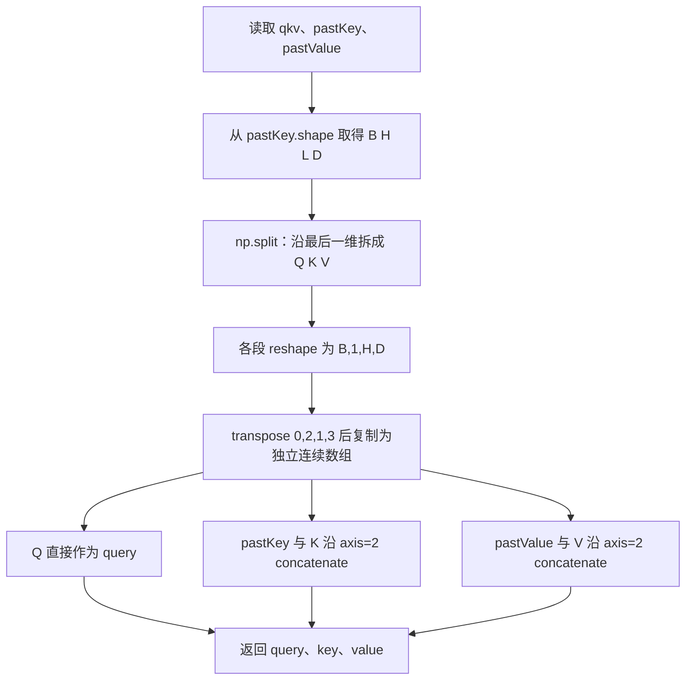
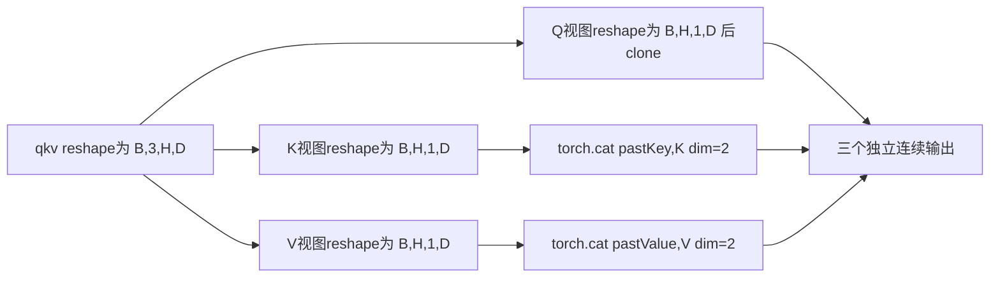
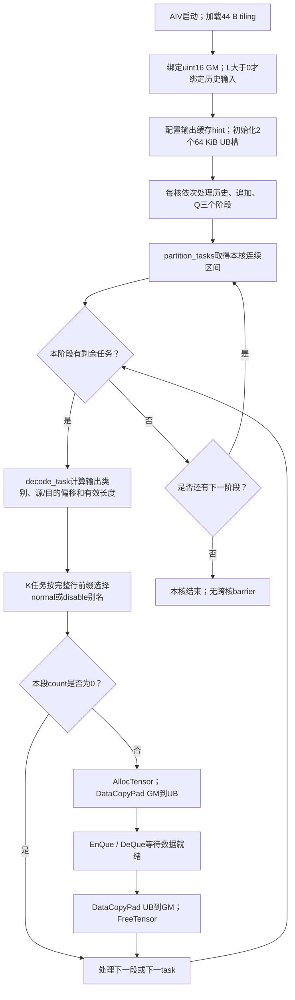

<!-- Copyright 2026 The xLLM Authors. Licensed under the Apache License, Version 2.0. -->

# 【社区任务】T5SplitQkvAppendCache算子设计文档

<!-- SUPPLEMENT_CURRENT -->
> 当前更新：同机基线10项已实测，真实精度/性能/内存截图已补入XLSX；02批次绝对门限5/10通过。当前数据、日志哈希、截图和限制以[补充测试记录](补充测试记录.md)为准。下文保留final_176_01历史数据与当时未闭合状态。


本算子面向 T5 单 token 解码，将融合 QKV 拆分为独立 Q，并把当前 K/V 追加到连续历史缓存。设计采用一次 AIV 内核启动、逐位搬运、零显式全局工作区，同时提供 ACLNN 和 Kernel 直调入口。

本文描述已实现并在开发环境测试的版本，不把设计覆盖等同于正式验收通过。35 个官方精度 case、10 个内存 case 和随包绝对耗时检查已通过；指定环境复测、同机合格基线性能比较及真实执行截图尚待补齐。

| 版本项 | 固定内容 |
| --- | --- |
| 文档日期 | 2026-10-29 |
| 仓库与交付分支 | `https://github.com/swenzhai/xllm`，`t5-qkv-task-submission` |
| 被测实现提交 | `ab70af7891455b36c7aaac6344f0f2207afcc068`；后续提交仅更新文档和交付附件 |
| 算子目录 | `xllm/core/kernels/npu/xllm_ops/t5_split_qkv_append_cache/`，下文简称 OP_ROOT |
| 设计审核依据 | `asctool/docs/official/设计文档CheckList.md`，原表第 2–24 行，共 23 项 |
| CheckList SHA256 | `e36651e3c496e19ce8b279c6412c7b673c0ef5503e1fbf4796a20fb8e90502cf` |
| 代码基线 | xLLM `3967b8a20adb238fd6302020563814d5e5c03493` |

## 一、需求背景

### 1.1 需求来源

需求来自《题目3-T5QKV拆分与缓存追加算子开发任务书》及同包 `op.json`、`case.json`、`coverage_requirements.json`。任务要求向 xLLM 的 NPU 算子目录贡献可构建的 Ascend C 实现，交付 OpDef、shape/dtype 推导、tiling、私有安装包、两阶段 ACLNN API、独立 C++ 样例和 PyTorch NPU 封装，并通过直调交叉验证。

原始任务包保存在本交付的 `5 原始证据.zip` 内，目录为 `题目3-T5QKV拆分与缓存追加算子-独立包/`。公开 `case.json` 的 SHA256 为 `9ce34ba31fc08abe1969ad4997f7b6173fa950533473d6977398a8ed4db741e8`。原包保持不改。其任务书文件名/哈希与 `SHA256SUMS.txt` 不一致，且任务书的相对性能要求与随包绝对时间检查器不同，具体影响见 5.1、6.2。

### 1.2 背景介绍

#### 1.2.1 算子实现与优化对象

每个解码步只有一个新 token，但输出 K/V 必须拥有独立存储，所以历史数据仍须复制。优化重点是减少框架拆分、转置和拼接所需的调度及中间张量，并使历史复制、短尾追加和 Q 复制均衡分配到 Vector Core。算法没有矩阵乘、归约或浮点运算。

任务包未提供同名 TBE Python 算子源码或 CANN TBE 算子信息库文件；在上述 xLLM 起始提交中检索也未找到同名实现。因此，本任务是按指定接口新增融合算子，不能写成已完成某个既有 TBE 算子的源码迁移，也不能声称已对齐未提供的 TBE 全部功能。

| 对照对象 | 具体文件或符号 | 用途及边界 |
| --- | --- | --- |
| 任务算子信息 | 原任务包 `op.json` | 定义 `T5SplitQkvAppendCache`、三输入三输出、FP16/BF16、ND、两个 int 属性；不是 TBE 信息库 |
| 独立功能标杆 | 原任务包 `golden.py:calculate`、`calc_expect_func` | CPU NumPy/ml_dtypes 标杆；不调用提交实现，不是 TBE 内核 |
| 指定性能基线 | 原任务书 3.3 `candidates` 中 `views_concat_q_copy` | 同机 NPU 视图拆分、Q clone、两次 concat；当前没有该候选的实测数据 |
| 注册与推导 | OP_ROOT `op_host/t5_split_qkv_append_cache.cpp` | OpDef、输入输出约束、shape/dtype 推导与 tiling |
| ACLNN API | 构建生成 `aclnn_t5_split_qkv_append_cache.h` | `aclnnT5SplitQkvAppendCacheGetWorkspaceSize` 与 `aclnnT5SplitQkvAppendCache`；独立样例实际调用这两个符号 |

`op.json` SHA256 为 `9bccb18b2dbfb48e7f4affc30141d0c0313d7269a1edd88cb0eab76641188357`，`golden.py` SHA256 为 `258c322025f5875bb89a2529c2d85659d96ee5bb9526f292dce3b3ca7648021a`。通过算子名、输入输出顺序、属性顺序及上述 ACLNN 符号对照，确认参考文件对应当前算子。

#### 1.2.2 算子现状分析

##### 1.2.2.1 数据类型与数据格式

输入及输出均为 FP16 或 BF16，单次调用所有张量 dtype 相同；算子注册与独立 binding 的 ACL 描述符均使用 ND。框架额外接受普通连续 rank-four 张量的 NCHW 格式标记，其线性存储在本场景与 ND 相同，不表示支持私有打包布局。CPU 输入、FP32、非连续切片和 NZ 等设备私有格式不在合同内。

##### 1.2.2.2 参考实现逻辑

`golden.py:calculate` 从历史 Key 取得 B/H/L/D，沿 `qkv` 最后一维等分成 Q/K/V。三段分别 reshape 为 `[B,1,H,D]`，交换 token/head 两轴得到 `[B,H,1,D]`，再用 `np.array(copy=True, order="C")` 创建独立连续数组。Q 直接输出，K/V 分别与历史缓存在 token 轴（axis=2）拼接。属性兼容转换在 `calc_expect_func` 中完成；合法性校验由公开验证器及提交入口承担，不能把标杆函数当作完整非法输入验证器。

任务书的 NPU 性能候选采用同一输出语义，但 K/V 仅作视图再 concat，不为当前 K/V 额外 clone；Q 显式 clone。它与 CPU 标杆的临时数组行为不同，测量时应使用任务书指定候选。

##### 1.2.2.3 参考实现流程图

下图严格对应已提供的 CPU `golden.py`，是没有同名 TBE 源码时的语义对照图，并非虚构的 TBE 执行流程。



任务书NPU性能候选的逻辑流程如下，后续同机比较应执行该候选，不能拿CPU耗时代替。



## 二、需求分析

### 2.1 外部组件依赖

| 依赖 | 目标或实测版本 | 使用位置 |
| --- | --- | --- |
| Ascend C/CANN、ACL Runtime | 9.1.0，构建目标 `ascend910_93` | AIV 内核编译、OpDef/tiling、ACLNN 生成与运行 |
| 主机平台 | aarch64 Linux | `.run` 安装包、C++ 库、Python 扩展 |
| Python | 3.12.13 | 验证脚本、扩展构建、Python 接口 |
| PyTorch | 2.10.0+cpu | ATen 张量和扩展 ABI；NPU 执行由 torch_npu 提供 |
| torch_npu | 2.10.0.post4，git `5dd8ef3f9b375b5ae4a83538d5785754148c3302` | 当前 stream、OpCommand host queue、NPU 缓存分配器 |
| NumPy / ml_dtypes | 2.2.6 / 0.6.0 | CPU 独立标杆、BF16 原始位模式 |
| 构建工具 | CMake、C++17 工具链、setuptools、wheel、ninja | 具体调用见构建脚本；工具精确版本未在全部证据中固定，不作跨版本 ABI 承诺 |

运行时不依赖 NumPy 计算输出。独立 C++ ACLNN 样例不依赖 PyTorch。自定义包安装至用户私有目录，安装脚本拒绝系统目录及当前 CANN 安装树。

### 2.2 内部适配模块

| 模块 | 具体文件 | 职责 |
| --- | --- | --- |
| 注册和 host tiling | `op_host/t5_split_qkv_append_cache.cpp` | 约束检查、输出推导、工作区0、blockDim、tilingKey |
| 共用 tiling / 地址映射 | `common/t5_split_qkv_append_cache_tiling.h` | 44 B POD、尺寸边界、任务数、分核、任务解码 |
| AIV kernel | `op_kernel/t5_split_qkv_append_cache.cpp`、`..._kernel.h` | ACLNN/直调实例共用复制实现 |
| 直调 launcher | `direct/launch.cpp`、`direct/CMakeLists.txt` | 按值传递 tiling、当前 stream 启动 |
| 框架入口 | `solution.py`、`framework/binding.cpp` | 元数据校验、新输出分配、stream/lifetime、两阶段 API |
| xLLM 原生封装 | `xllm/core/kernels/npu/xllm_ops/t5_split_qkv_append_cache.cpp`、`xllm_ops_api.h` | 接入既有 `EXEC_NPU_CMD` 机制；不是独立 binding 的同一条调用路径 |
| 构建与样例 | `scripts/`、`examples/aclnn_example.cpp` | 包构建、私有安装、扩展构建、两阶段调用与逐位检查 |
| 可测模块 | `tests/acceptance.py`、`queue_stress.py`、`cache_boundary.py`、`check_task_mapping.*` | 精度、异常、生命周期、内存、边界与地址覆盖检查 |

独立工程放在 xLLM NPU wrapper 目录旁，不修改 xllm_ops 子模块。原生 wrapper 已完成基于实际 xLLM 头文件和宏的语法/类型编译；未证明完整服务构建、链接、T5 模型业务调用或端到端推理已经集成。

### 2.3 需求模块设计

#### 2.3.1 Ascend C 算子原型

令 `R=B×H`，`N=B×H×D`。qkv 按全部 Q、全部 K、全部 V 顺序打包。

| 名称 | 输入/输出 | shape | dtype/格式 | 约束 |
| --- | --- | --- | --- | --- |
| qkv | 输入 | `[B,1,3HD]` | FP16/BF16，ND | token 维严格为1 |
| pastKey、pastValue | 输入 | `[B,H,L,D]` | 与 qkv 一致，ND | 两者 shape 完全相同，L允许0 |
| query | 输出 | `[B,H,1,D]` | 与输入一致，ND | 新分配、连续 |
| key、value | 输出 | `[B,H,L+1,D]` | 与输入一致，ND | 新分配、连续，互不共享底层存储 |
| headNum、headDim | 属性 | int 标量 | 注册默认值均为1 | 必须分别等于 H、D |

Python 调用为 `run(inputs, attributes) -> (query,key,value)`、`run_direct(inputs, attributes)`；`prepare(inputs, attributes)` 返回接收新输入列表的 callable。inputs必须是长度3的list/tuple，attributes必须为dict；两属性缺省均为1，不从非1的输入shape自动推断。属性必须为严格int，最终传给ACLNN的H/D必须与shape一致。C++ 调用使用构建生成的两阶段原型：

```cpp
aclnnStatus aclnnT5SplitQkvAppendCacheGetWorkspaceSize(
    const aclTensor* qkv, const aclTensor* pastKey,
    const aclTensor* pastValue, int64_t headNum, int64_t headDim,
    const aclTensor* query, const aclTensor* key, const aclTensor* value,
    uint64_t* workspaceSize, aclOpExecutor** executor);
aclnnStatus aclnnT5SplitQkvAppendCache(
    void* workspace, uint64_t workspaceSize,
    aclOpExecutor* executor, aclrtStream stream);
```

以构建生成的头文件为 ABI 权威。正常工作区查询必须得到0；执行阶段传 `nullptr, 0`。executor 为普通一次性对象，由执行阶段消费，不跨调用缓存复用。

直调C ABI为 `uint32_t t5qkv_launch(uint32_t block_dim, void* stream, void* qkv, void* past_key, void* past_value, void* query, void* key, void* value, T5SplitQkvAppendCacheTilingData tiling)`。原生C++接口位于`xllm::kernel::npu`，接收三个`const torch::Tensor&`和两个int64属性，返回三个Tensor的tuple。`validate_out`是只检查输出元数据/存储的工程测试helper，不是调用者提供输出的`out=`计算接口；`workspace_size`返回静态0，真实ACLNN query也会在每次正式run中独立检查0工作区。

#### 2.3.2 算子相关约束与缺失功能

`1≤B≤64`、`1≤H≤128`、`1≤D≤256`、`0≤L≤8192`，同时约束 `N(2L+3)≤2^28`。这些边界不是可任意组合的独立上限。支持奇数 D、非32 B对齐 GM 起址，以及连续且非零 storage_offset 的输入视图。

不支持多 token、GQA、RoPE、分页 KV cache、原位追加、输出别名、FP32/INT8、非连续输入或不同设备/不同dtype混用。这里的“缓存追加”生成完整新 K/V，不管理上层缓存池或页表。由于同名 TBE 源码缺失，不能给出其额外特性的已对齐清单；本实现相对任务接口没有主动删除所要求的功能。

## 三、需求详细设计

### 3.1 使能方式

先用 `scripts/build.sh` 构建注册/tiling/kernel 和 `.run`，用 `scripts/install.sh` 安装至私有前缀，再加载私有 vendor 环境并设置 `T5QKV_OPAPI_LIB`。`scripts/build_framework.sh` 构建 direct 库和 `_t5qkv` 扩展。完整命令、产物哈希和测试命令见同目录《1 自验证步骤说明》。

独立 Python 正式入口的顺序为：检查输入/属性 → NPUGuard选择输入设备并获取当前stream → 分配三块新输出 → 记录输入存储的stream使用 → `OpCommand::RunOpApi`排队 → 返回输出；callback按队列顺序异步创建描述符并执行两阶段ACLNN。这里不调用强制排空host queue的同步接口。业务调用保持异步，测试在比较或计时边界同步。

callback按值捕获六份固定`TensorMetadata`（shape、stride、dtype及视图地址）、tiling、标量和stream，不持Tensor/Storage或Python storage wrapper。worker无需销毁Python关联存储所有者；六个RAII aclTensor描述符在callback内覆盖两阶段调用。API库首次解析后保持至进程退出，避免异步任务引用卸载代码。参数错误及API失败向调用方传播，不进行吞错重试或自动切换direct；异步设备错误可能在后续同步时暴露。

直调入口沿用同样的校验、分配和排队方式，在 callback 中调用 `t5qkv_launch`。direct tiling 使用目标平台固定上限48；ACLNN tiling 从平台取得可用 AIV 核数再限制到48。两者只针对本任务目标配置交叉验证，不应当成任意型号上的通用 launcher。

原生 xLLM wrapper 使用 `EXEC_NPU_CMD`：工作区查询位于调用线程，execute 随宏的 host queue 机制提交。它与独立 binding 的 callback 内双阶段方式必须区分，其集成验证范围见 2.2。

独立binding强制ND描述符，并对非零workspace报错；原生宏使用通用tensor描述转换与工作区分配机制。该差异是原生路径仍需真实完整集成验证的原因之一，不能用独立binding的测试结果证明原生宏的所有运行行为。

### 3.2 需求总体设计

#### 3.2.1 Host 侧设计

Host 先验证 rank、维度范围、两份缓存 shape、dtype、格式、属性与输出 shape，再做乘法。总输出元素数用 uint64 计算，越界即拒绝；合法的 task 偏移和数量可用 uint32 表示。共享 POD 为11个 uint32字段，共44 B，host/device 用静态断言固定布局。

##### 3.2.1.1 分核策略

每块上限 `T=32768` 个 uint16 元素。单 head 历史长度 `E=L×D`，每 head 历史块数 `C=ceil(E/T)`；每 batch Q 的块数 `Qb=ceil(H×D/T)`。当 L=0，C=0，不创建历史任务。

任务空间固定分为三段：

| 阶段 | 起始 task id | 任务数量 |
| --- | ---: | ---: |
| K/V 历史复制 | 0 | `Th=2×R×C` |
| K/V 当前 token 追加 | Th | `Ta=2×R` |
| Q 复制 | Th+Ta | `Tq=B×Qb` |

`total_tasks=Th+Ta+Tq`，ACLNN `P=blockDim=min(total_tasks,min(availableAiv,48))`。每个阶段分别做连续均衡分配：阶段起点 F、数量 M，令 `q=floor(M/P)`、`r=M mod P`，核 c 获得 `[F+cq+min(c,r), F+cq+min(c,r)+q+[c<r])`。任一阶段内核间任务数差不超过1；M<P时允许部分核该阶段没有任务。

每核按历史、追加、Q 的顺序执行自己的任务，没有全核 barrier。三个阶段写入互不重叠的逻辑区间，追加不读取已写输出，因此无需跨核同步。分开均衡追加任务，避免短复制全部集中到执行最后历史块的少数核。

例：官方007的 `(B,H,L,D)=(16,16,2048,64)`，R=256，C=4，Qb=1，Th=2048、Ta=512、Tq=16、总任务2576、P=48。历史每核42或43个任务，追加10或11个任务，Q仅16个核各1个任务；不能把P=48解释为三个阶段均有48个活跃核。

##### 3.2.1.2 分块和内存优化策略

每个历史任务仅覆盖一个 head 的连续片段；尾块长度 `min(T,E-tT)`。追加任务搬运 D 个元素，Q任务搬运 batch 内至多T个连续元素。采用2槽 `TQueBind<VECIN,VECOUT,2>`：每槽 `32768×2=65536 B`，每个执行核总 UB 数据缓冲 `2×65536=131072 B`。这是片上缓冲，不计入显式全局workspace。

每次拷贝都从独立、32 B对齐的 UB 槽首址开始；不把追加数据接在可能未对齐的历史尾块 UB 地址上。最大单次搬运为65536 B，`DataCopyExtParams` 的 blockCount=1、blockLen=`count×2` 字节、两端stride=0。GM→UB 不主动填充有语义的数据，UB→GM仅写有效字节，不将对齐padding写入邻接输出。

总输出元素 `O=N(2L+3)`，输出字节 `Mout=2N(2L+3)`。输入恰好也是 Mout 字节；每个有效输入元素理想情况下读一次、每个输出元素写一次，因此最小逻辑 GM 读写量为 `2Mout=4N(2L+3)` B。该值不包含缓存行放大、写分配、元数据和框架开销，不能直接当作实测HBM带宽。

显式全局workspace=0，无中间设备张量。ACLNN tiling 是运行时启动元数据，direct 的44 B POD按值进入启动参数，不为其申请设备工作区。框架只分配三块最终输出；验收分配器允许输出字节以外16 KiB对齐余量。

L2策略预算 `S=176×2^20=184549376 B`，不是硬件预留或额外内存分配。令整个输入输出逻辑工作集 `W=8NL+12N`。W≤S时使用正常缓存；W>S时V输出使用disable hint，同时计算保留输入和Q后的预算 `A=4N(L+2)`、`remaining=max(0,S-A)`。每个K输出head行 `rowBytes=2(L+1)D`，正常缓存的完整K行数为 `min(R,floor(remaining/rowBytes))`，其余K行使用disable hint。输入本身若超过预算，算法不会把全部工作集强行限制在176 MiB内。

K的两个GlobalTensor别名指向同一输出存储及同一逻辑元素范围，区别只有缓存hint；任务按首个输出偏移与缓存前缀边界比较选择别名。前缀只以完整head行划分，而任务不跨head，故单个任务不会跨越前缀边界。大非对齐边界测试专门覆盖该条件。direct旧编译链未启用所需L2运行时配置，hint不生效，仍保持相同逐位复制语义；官方耗时只测ACLNN `run`。

官方007的 Mout=134316032 B，W=268632064 B，A=134348800 B，remaining=50200576 B，rowBytes=262272 B，K正常缓存前缀191行。预算值来自该开发环境的优化选择；不能将源码注释中的平台L2容量或一次测量外推为所有设备的保证。

##### 3.2.1.3 tilingKey 规划

当前唯一 `tilingKey=0`，所有合法FP16/BF16形状共用同一uint16搬运内核。L=0、长短缓存、奇数D和尾块由tiling字段与任务解码处理；L2 hint也不分配新key。未来增加新key须同时更新host选择条件、device dispatch、两入口的一致性验证，不能仅增加未使用的host标记。

| POD字段 | 含义 |
| --- | --- |
| batch/head_num/past_length/head_dim | B/H/L/D |
| tile_elements | T=32768 |
| cache_tiles_per_head | C=ceil(LD/T) |
| query_tiles_per_batch | Qb=ceil(HD/T) |
| cache_tasks_per_tensor | R×C，单份K或V历史任务数 |
| query_tasks | B×Qb |
| total_tasks | 2RC+2R+BQb |
| block_dim | 启动Vector Core数P |

#### 3.2.2 Kernel 侧设计

##### 3.2.2.1 实现描述与地址推导

以 uint16 元素为偏移单位，令 head行 `r=bH+h`、历史行长E=LD、输出行长J=(L+1)D。输入tensor的data pointer已包含storage offset，以下偏移均相对该指针，不再重复叠加offset。

| 数据段 | 读偏移 | 写偏移 | 长度 |
| --- | --- | --- | --- |
| Q的batch块t | `b×3HD+tT` | `b×HD+tT` | `min(T,HD-tT)` |
| K/V历史块t | `r×LD+tT`，对应pastKey或pastValue | `r×J+tT`，对应key或value | `min(T,LD-tT)` |
| 当前K | `b×3HD+HD+hD` | `r×J+LD` | D |
| 当前V | `b×3HD+2HD+hD` | `r×J+LD` | D |

历史任务首先确定K/V张量，再以商余数确定head与tile；追加任务确定K/V及head；Q任务确定batch与tile。三类区间恰好覆盖Q、历史K/V、最后token且彼此不交叠。每个有效输出元素有唯一writer，不需atomic或归约。L=0时历史GlobalTensor不绑定，history任务数为0，`copy_segment(count=0)`在解引用source之前返回，避免读取空缓存。

`copy_segment`依次执行 AllocTensor、DataCopyPad(GM→UB)、EnQue、DeQue、DataCopyPad(UB→GM)、FreeTensor。队列依赖管理搬运就绪及槽复用；2槽设计不等于已经证明所有搬运完全重叠。整个路径没有FP16/BF16算术或类型转换，NaN payload、Inf、正负零与普通值均按原始16位复制。

本机接口索引《Ascend C 9.1.0-beta.1 接口参考》2.3.1.2（238–248页）将DataCopyPad标为A3支持的ISASI接口：LocalTensor首址须32 B对齐，GlobalTensor无首址对齐要求；当前使用带uint32 blockLen的扩展参数，65536 B低于其2097151 B上限。2.2.2.12（138–139页）列出SetL2CacheHint对A3的支持。手册版本用于静态约束核对，实际CANN9.1.0构建与设备结果另有原始证据；不声称这些接口能无条件跨平台使用。

##### 3.2.2.2 Ascend C 实现流程图



##### 3.2.2.3 与参考流程的差异及原因

| 参考流程 | 当前Ascend C流程 | 原因与等价性 |
| --- | --- | --- |
| split、reshape、transpose | 直接计算打包QKV偏移 | shape语义相同，不生成转置中间张量 |
| CPU标杆复制当前Q/K/V再concat | Q直接写最终输出；K/V历史与新token分别写最终区间 | 输出独立存储不变，去掉中间K/V复制 |
| 参考按Q、K、V逻辑顺序构造 | 每核历史、追加、Q三阶段均衡处理 | 不同输出区间无依赖，调度顺序不改变位结果 |
| 标杆使用数组操作 | uint16 DataCopyPad与队列同步 | 不经过浮点计算，保持任意16位模式 |
| 未规定L2策略 | ACLNN按工作集选择输出hint | 只改变访存策略，不改变地址映射与数据内容 |

因为未提供同名TBE源码，不能断言上表就是“与TBE源码”的逐行差异。若社区评审指定实际TBE文件，需补其文件名、版本、原始流程图和逐分支对照后再作兼容性结论。

### 3.3 支持硬件

目标为昇腾910C / Atlas A3、Ascend910_9382、单个逻辑设备、48个Vector Core及24个Cube Core。本内核声明AIV_ONLY，不使用Cube。注册/编译目标为`ascend910_93`；没有承诺910B、初代910或950支持。

开发实测为Ascend910_9382、CANN9.1.0、Ubuntu22.04.5、driver26.1.1；验收指定openEuler24.03 LTS-SP3和driver25.5.t6.b001尚未复测。环境报告曾显示两个可见设备，测试选择逻辑0，这不等于已证明“仅暴露单逻辑设备”的部署配置。正式复测应按分配设备设置可见性并使用容器逻辑0。

### 3.4 算子约束限制

除2.3.2的shape/dtype/格式约束外，三个输入必须位于同一NPU设备。Python拒绝未知属性、bool/字符串/浮点数属性及不匹配的H/D。普通C++ ACLNN调用方须保证设备指针有效、描述符ND、内存足够且输出存储不重叠，host shape推导不能检测所有底层指针所有权问题。

输入由torch_npu分配器管理时，提前释放通过记录stream使用保护；外部分配、IPC或自定义allocator的生命周期由外部拥有者负责。`prepare`只保存元数据，不缓存输入、输出、地址、stream或executor，每次调用仍分配新输出。支持动态合法尺寸的逐次eager调用，不代表已验证图捕获、图执行或训练反向。

`recordStream`保护释放/复用，不负责等待另一stream上的生产者写入完成。输入若由另一stream生产，调用者须先建立event/wait_stream依赖；输出由另一stream消费时也须履行框架的流依赖和寿命规则。`prepare`固定的是(B,H,L,D,device_index,dtype)，允许每次使用不同地址、合法storage offset和当前stream，同时重新校验连续性与基础格式。当前未验证多个host线程并发首次加载库。

## 四、特性交叉分析

| 交叉特性 | 设计行为 | 验证及边界 |
| --- | --- | --- |
| FP16/BF16与特殊位模式 | 两类型均按uint16搬运 | 官方35case全部逐位验证，含9个audit；不是数值容差测试 |
| L=0与空缓存 | 跳过历史绑定/任务/有效读 | 最小shape及大head边界用例覆盖 |
| 奇数D、尾块、storage offset | 精确字节长度、UB槽首址对齐 | 12个额外输入在两入口测试；大奇数行边界另有8条补充记录 |
| 当前stream与host queue | 排队顺序服从OpCommand；固定元数据值捕获 | 双独立stream、提前释放、长队列压力验证；不跨stream私自插入全局同步 |
| 输入提前释放 | 排队前对input storage recordStream，释放事件排在使用之后 | 各入口有提前释放压力；worker不持Python关联Tensor/Storage所有权 |
| 输出提前释放 | 输出属当前分配stream，同流后续复用在已提交操作之后 | 保留8次输出、32次提前释放输出压力；并非任意外部allocator保证 |
| 多次追加 | 前一次K/V可作为下一次历史输入；仍生成新存储 | L=31代表输入连续追加两次，最终长度L+2 |
| 内存回收与高调用数 | 零显式workspace；不保存跨调用结果 | 018两入口各20次回收，005两入口各8192次队列压力；不把重复次数当独立case |
| direct与ACLNN | 共用task映射/位复制；不同launch与hint环境 | 精度交叉验证；性能只声明ACLNN入口结果 |
| 多设备与异步错误 | 每次检查设备一致并用输入设备当前stream；失败向调用路径传播 | 非本任务的多卡通信、图捕获和外部分配生命周期未验证 |

## 五、可维可测分析

### 5.1 精度标准与性能标准

#### 精度与功能

全部输出逐位一致，差异元素数必须为0，包括任意NaN、Inf及正负零。还必须验证输入不变、输出数量/shape/dtype/device/连续性以及底层存储独立；只比较起始data pointer不能代替存储所有权检查。原版`verify.py`执行35个官方case，`tests/acceptance.py`增加两入口及工程场景。

| 已测项目 | 结果与范围 |
| --- | --- |
| 官方精度 | 35/35通过，三输出位差异均0 |
| 两入口公开精度 | 35×2=70条；不是70个独立输入 |
| 额外输入/非法场景 | 12×2=24条、28×3=84条 |
| 扩展总记录 | 206/206，含metadata6、verifier3、streams1、input_lifetime2、output_lifetime2、recovery2、append2、memory10 |
| 长队列/释放压力 | run和run_direct各8192次，且各100轮输入提前释放压力 |
| 大非对齐边界 | 8/8；两入口、两dtype、offset0/1 |
| C++ ACLNN样例 | FP16/BF16 bit_exact=1，workspace_bytes=0 |

任务映射CPU检查用于证明区间/来源映射，不替代NPU实测。复现和原始返回码见步骤说明及证据包；本次新增设计文档不重写或追加成功测试日志。

#### 性能

正式任务书要求提交实现与至少一个合格候选基线在同一NPU、同一输入上测量，基线亦须通过精度与存储要求。协议为预热50次，5轮×200次，每轮完成同步后除以200，取5个轮均墙钟us的中位数；每次分配新输出，输入传输与golden比较不计时。设备事件时间包含提交间隙，不称纯kernel耗时。

当前随包`benchmark.py`及`check_performance.py`执行绝对us门槛，保留10项共50个墙钟轮均值和50个事件轮均值，10项绝对检查均通过；这些结果不能替代任务书的同机基线比值。模板标杆和rato列据实标记未测/不可计算，不能拿绝对上限或任务书参考基线当实测分母。任务书文字称“耗时比上限”，表头却为“目标耗时上限”且与绝对脚本同值，需发布方确认最终量纲及判据。

#### 内存

任务要求显式全局workspace=0。输入预先分配并预热，10个`performance=true`用例各记录一次调用的allocated和active峰值增量，两者均不超过`Mout+16384 B`，释放并同步后回到调用前水平。20次重复回收只在018对run/run_direct各执行一条记录，不宣称35个case或10个内存case逐项做过20次。

指标来自PyTorch NPU张量分配器，包含输出及其分配对齐，排除整卡HBM、driver reserved缓存和片上UB；F列GB采用`peak_active_delta/10^9`。分配器回收证明的是被测路径和统计范围，不等于完整运行时所有内部资源的泄漏证明。

### 5.2 兼容性分析与维护

FP16/BF16共享一份uint16 kernel，形状上下界及44 B tiling布局集中管理，ACLNN与direct共用同一helper，避免地址算法分叉。框架校验在Python/C++边界保留，异常不返回伪造成功输出。

torch/torch_npu ABI、OpCommand排队和allocator recordStream语义均绑定本次版本；升级框架、CANN、驱动、设备或搬迁工程后应重新构建并重跑精度/生命周期/内存/性能。direct使用新的构建目录防止legacy预处理复用旧对象；Python扩展记录direct库构建位置，移动项目需要重建。旧版direct hint不生效这一差异不外推到未来工具链。

维护时优先修改共享tiling/映射和kernel，再复查两入口的边界。007/017大缓存性能余量较小，任何策略变化均须保留完整5轮协议及失败原件，不能只替换最有利样本。当前不承诺训练反向、图捕获、多卡通信、跨框架版本或完整xLLM服务的兼容性。

## 六、交付与社区审核流程

### 6.1 设计文档 PR 信息

建议正式设计评审PR标题为本文件标题：`【社区任务】T5SplitQkvAppendCache算子设计文档`。CheckList要求提交到 `https://gitcode.com/cann/cann-competitions/tree/master/04_tasks/01_community-task-2026/tasklist` 中对应任务位置，必须是PR而非issue，并要求CLA签署与PR评论`/compile`触发构建。

当前已交付的是用户指定GitHub仓库中的分支和文件；正式社区PR尚未创建，对应任务的具体子目录尚未确认，CLA签署状态未核实，`/compile`尚未执行，均不得标为已完成。任务书第5节另指向xLLM代码合入位置，其代码PR与上述社区设计PR是两项不同流程。本文不以分支链接或commit链接代替PR凭证。

### 6.2 未闭合事项

| 事项 | 当前状态 | 后续完成条件 |
| --- | --- | --- |
| 正式环境 | 开发OS/driver与指定版本不同 | 在指定镜像/驱动/单逻辑设备配置复测并冻结新证据 |
| 性能判据/基线 | 绝对脚本通过，同机基线比值未测 | 确认量纲和权威判据，补合格候选及5轮同机数据 |
| TBE对照 | 任务未提供同名源码/信息库 | 社区确认本新增算子的N/A口径；若指定参考则补逐分支对照 |
| 原任务书 | 文件名及内容hash与原manifest不匹配 | 发布方确认权威版本；保留当前原件与差异 |
| 现场截图 | 三报告截图栏已明确缺项 | 补与实际被测提交/批次对应的真实执行截图 |
| 全服务集成 | native wrapper仅语法/类型编译 | 完整构建/链接、模型实际调用和端到端测试 |
| 社区流程 | 设计PR、CLA、compile未闭合 | 使用真实PR及构建结果逐项更新附录CheckList |

## 七、源码与证据索引

以下链接固定在被测实现提交；交付文件位于新分支`task_submission/`。本次文档引用的任务包、JSON、日志和安装包可在`5 原始证据.zip`找到；未归档逐输入/golden/output二进制，重建依据为原始固定种子生成器、case定义与验证器。

| 编号 | 文件 | 主要设计依据 |
| --- | --- | --- |
| S1 | [共用tiling与任务映射](https://github.com/swenzhai/xllm/blob/ab70af7891455b36c7aaac6344f0f2207afcc068/xllm/core/kernels/npu/xllm_ops/t5_split_qkv_append_cache/common/t5_split_qkv_append_cache_tiling.h) | 边界、44 B布局、任务数、均衡分核和地址 |
| S2 | [OpDef及host](https://github.com/swenzhai/xllm/blob/ab70af7891455b36c7aaac6344f0f2207afcc068/xllm/core/kernels/npu/xllm_ops/t5_split_qkv_append_cache/op_host/t5_split_qkv_append_cache.cpp) | dtype/shape、ND、key0、workspace0、AIV数 |
| S3 | [Kernel实现](https://github.com/swenzhai/xllm/blob/ab70af7891455b36c7aaac6344f0f2207afcc068/xllm/core/kernels/npu/xllm_ops/t5_split_qkv_append_cache/op_kernel/t5_split_qkv_append_cache_kernel.h) | 三阶段、UB、DataCopyPad、L2 hint |
| S4 | [Kernel入口](https://github.com/swenzhai/xllm/blob/ab70af7891455b36c7aaac6344f0f2207afcc068/xllm/core/kernels/npu/xllm_ops/t5_split_qkv_append_cache/op_kernel/t5_split_qkv_append_cache.cpp) | AIV_ONLY与两种参数传递方式 |
| S5 | [框架binding](https://github.com/swenzhai/xllm/blob/ab70af7891455b36c7aaac6344f0f2207afcc068/xllm/core/kernels/npu/xllm_ops/t5_split_qkv_append_cache/framework/binding.cpp)、[solution.py](https://github.com/swenzhai/xllm/blob/ab70af7891455b36c7aaac6344f0f2207afcc068/xllm/core/kernels/npu/xllm_ops/t5_split_qkv_append_cache/solution.py) | 元数据、输出所有权、stream及两阶段调用 |
| S6 | [C++样例](https://github.com/swenzhai/xllm/blob/ab70af7891455b36c7aaac6344f0f2207afcc068/xllm/core/kernels/npu/xllm_ops/t5_split_qkv_append_cache/examples/aclnn_example.cpp) | ACLNN ABI和workspace实测 |
| S7 | [验收测试](https://github.com/swenzhai/xllm/blob/ab70af7891455b36c7aaac6344f0f2207afcc068/xllm/core/kernels/npu/xllm_ops/t5_split_qkv_append_cache/tests/acceptance.py) | 官方/额外/异常/stream/内存检查 |
| S8 | [原生wrapper](https://github.com/swenzhai/xllm/blob/ab70af7891455b36c7aaac6344f0f2207afcc068/xllm/core/kernels/npu/xllm_ops/t5_split_qkv_append_cache.cpp) | xLLM EXEC_NPU_CMD集成入口 |

服务器原始归档 `evidence_ab70af7.tar.gz` SHA256：`cc9d89474fdefe205035b26cebdc4d2174f37692a2cb31a0cf92e06e405dcfaa`。本交付证据ZIP是派生选择包，不能混称服务器原件。执行记录为`development_evidence/20261029_ab70af7/raw/reports/final_176_01/`下的原始JSON/log；加载库身份及前后hash分别见`runtime_identity.json`、`pretest_manifest.json`和`source_manifest.json`。

## 附录A CheckList逐项对照

本表完整保留原表第2–24行的审核要求。状态区分文档是否覆盖、功能是否实测和社区流程是否完成；不能把“23项均已列出”解读为“23项均已通过正式审核”。

| 原行号 | 审核项目 | 原审核要求 | 本文章节 | 状态 | 对应说明 |
| --- | --- | --- | --- | --- | --- |
| 2 | 设计文档PR / 提交位置 | 要求：1、必须是 PR，不是 issue；2、提交到对应的代码仓 `https://gitcode.com/cann/cann-competitions/tree/master/04_tasks/01_community-task-2026/tasklist` 的对应位置；3、CLA 必须签署以及必须进行构建，PR 评论 `/compile` | 6.1、6.2 | 流程待完成 | 社区PR与compile未执行，具体任务子目录待确认，CLA状态未核实；不用GitHub分支充当PR。 |
| 3 | 设计文档PR / 标题 | 要求：【社区任务】${算子名称}算子设计文档，如【社区任务】Addcdiv 算子设计文档 | 标题、6.1 | 文档标题已采用；PR待创建 | 标题为【社区任务】T5SplitQkvAppendCache算子设计文档。 |
| 4 | 设计文档内容 / 一、需求背景 / 1.1需求来源 | 示例：通过社区任务完成开源仓算子贡献的需求 | 1.1 | 已覆盖 | 任务书、任务包、贡献目标与固定实现提交已列明。 |
| 5 | 设计文档内容 / 一、需求背景 / 1.2背景介绍 / 1.2.1XXX算子实现优化 | 包含 TBE 算子源码获取路径和算子信息库路径，需包含文件名，结合 aclnn 接口判断参考文件是否正确 | 1.2.1、七 | TBE来源未提供，需确认N/A | 明确未提供同名TBE/信息库；给出op.json、golden.py、OpDef和生成ACLNN头文件及符号。 |
| 6 | 设计文档内容 / 一、需求背景 / 1.2背景介绍 / 1.2.2XXX算子现状分析 / 1.2.2.1TBE算子支持的数据类型和数据格式 | 和算子信息库要求保持一致 | 1.2.2.1、2.3.1 | 任务接口已对齐；TBE对齐未证实 | FP16/BF16、ND和基础NCHW标记边界与任务信息一致。 |
| 7 | 设计文档内容 / 一、需求背景 / 1.2背景介绍 / 1.2.2XXX算子现状分析 / 1.2.2.2TBE算子实现描述 | 对 TBE 实现逻辑和实现方案进行详细描述，与 TBE 源码逻辑完全一致 | 1.2.2.2 | 参考逻辑已覆盖；同名TBE缺失 | 精确说明CPU标杆与NPU候选，不把它们称为TBE源码。 |
| 8 | 设计文档内容 / 一、需求背景 / 1.2背景介绍 / 1.2.2XXX算子现状分析 / 1.2.2.3TBE算子实现流程图 | 与 TBE 源码逻辑完全一致，需要重点关注 | 1.2.2.3 | 参考流程图已覆盖；同名TBE缺失 | 分别给出CPU标杆与任务指定NPU候选图；真实TBE若指定需补图。 |
| 9 | 设计文档内容 / 二、需求分析 / 2.1 外部组件依赖 | 根据实际情况选择已适配的外部依赖 | 2.1 | 已覆盖 | 构建/运行依赖、版本及ABI限制分列。 |
| 10 | 设计文档内容 / 二、需求分析 / 2.2 内部适配模块 | 根据实际情况选择已适配的内部模块 | 2.2 | 已覆盖 | 列出内部文件职责，明确原生wrapper与独立binding及验证范围。 |
| 11 | 设计文档内容 / 二、需求分析 / 2.3 需求模块设计 / 2.3.1 AscendC算子原型 | 除《算子任务书》中不要求适配的部分外，其他 TBE 算子对齐 | 2.3.1 | 任务原型已覆盖；TBE对齐未证实 | 三输入三输出、属性/默认值、ACLNN两阶段、direct/Python/native入口均列出。 |
| 12 | 设计文档内容 / 二、需求分析 / 2.3 需求模块设计 / 2.3.1 AscendC算子相关约束 | 填写与 TBE 算子相比缺失哪些功能 | 2.3.2、3.4 | 任务边界已覆盖；TBE差异未知 | 列明排除功能和未验证能力，不编造未知TBE的能力列表。 |
| 13 | 设计文档内容 / 三、需求详细设计 / 3.1 使能方式 | 根据实际开发任务，适配算子调用框架，当前主要是 ACLNN | 3.1 | 已覆盖 | 私有安装、ACLNN和直调使能、框架排队与原生宏路径。 |
| 14 | 设计文档内容 / 三、需求详细设计 / 3.2 需求总体设计 / 3.2.1host侧设计 / 3.2.1.1分核策略 | 描述算子数据分核策略 | 3.2.1.1 | 已覆盖 | 三组任务、P上限、连续均衡公式、007例子和无全核barrier。 |
| 15 | 设计文档内容 / 三、需求详细设计 / 3.2 需求总体设计 / 3.2.1host侧设计 / 3.2.1.2数据分块和内存优化策略 | 描述数据块切分策略和 LocalMemory 使用情况，需要给出详细描述和计算公式 | 3.2.1.2 | 已覆盖 | 32768元素tile、尾块、2×64KiB UB、0workspace、GM字节公式和L2预算边界。 |
| 16 | 设计文档内容 / 三、需求详细设计 / 3.2 需求总体设计 / 3.2.1host侧设计 / 3.2.1.3tilingKey规划策略 | 描述 tilingKey 的设置条件 | 3.2.1.3 | 已覆盖 | 所有合法输入固定key0，dtype/shape/L2不分新key。 |
| 17 | 设计文档内容 / 三、需求详细设计 / 3.2 需求总体设计 / 3.2.2kernel侧设计 / 3.2.2.1kernel侧实现描述 | 描述 Ascend C 算子 kernel 设计，与 TBE 源码流程保持一致 | 3.2.2.1 | 任务语义已覆盖；TBE对齐未证实 | 逐位复制、偏移推导、唯一writer、空缓存和队列顺序。 |
| 18 | 设计文档内容 / 三、需求详细设计 / 3.2 需求总体设计 / 3.2.2kernel侧设计 / 3.2.2.2AscendC实现流程图 | 根据实际 AscendC 算子设计输出流程图，需要重点关注 | 3.2.2.2 | 已覆盖 | 给出与当前device源码匹配的三阶段与DataCopyPad流程。 |
| 19 | 设计文档内容 / 三、需求详细设计 / 3.2 需求总体设计 / 3.2.2kernel侧设计 / 3.2.2.3AscendC实现流程图与TBE流程图存在的差异点和原因 | 详细描述 Ascend C 与 TBE 两者实现中存在的差异点，并给出原因 | 3.2.2.3 | 参考差异已覆盖；同名TBE缺失 | 按语义标杆对照消除中间张量、分核与hint；未声称未知TBE逐行一致。 |
| 20 | 设计文档内容 / 三、需求详细设计 / 3.3 支持硬件 | 与《算子任务书》要求支持的硬件保持一致 | 3.3 | 设计目标已覆盖；正式环境待复测 | A3/910C/9382、AIV_ONLY、ascend910_93及指定/实际版本差异。 |
| 21 | 设计文档内容 / 三、需求详细设计 / 3.4 算子约束限制 | 填写 Ascend C 算子的约束限制，如不支持什么数据类型，参数只支持哪几种场景等 | 2.3.2、3.4 | 已覆盖 | shape、dtype、布局、存储、跨流依赖、allocator与未验证能力。 |
| 22 | 设计文档内容 / 四、特性交叉分析 | 原清单未附额外文字要求，保留此章节。 | 四 | 已覆盖 | 特性交叉矩阵有行为、测试范围和限制，不以笼统支持代替。 |
| 23 | 设计文档内容 / 五、可维可测分析 / 5.1精度标准/性能标准 | 精度不低于 TBE，性能不低于 TBE | 5.1、附录B/C | 精度已测；完整性能标准待闭合 | 35精度、10绝对耗时/内存结果；TBE及同机基线性能未证明，未写性能不低于TBE。 |
| 24 | 设计文档内容 / 五、可维可测分析 / 5.2兼容性分析 | 原清单未附额外文字要求，保留此章节。 | 5.2 | 已覆盖 | 平台/框架ABI、构建路径迁移、双入口差异和升级复测范围。 |

## 附录B 全部35个官方case

尺寸元组按任务书表示(B,H,L,D)；三份XLSX主表及完整统计页均逐行保留以下相同ID。完整输入/输出shape和属性在case.json与各工作簿完整统计页，FP16/BF16输入输出每元素均为2 B。非performance项仍执行精度，只是不要求性能/内存测量。

| 官方Case ID | (B,H,L,D) | dtype | 数据模式 | 精度 | 性能/内存适用性 |
| --- | --- | --- | --- | --- | --- |
| T5SplitQkvAppendCache_000_float16_random | (1,1,0,1) | float16 | random | 通过，位差异0 | 不适用：任务书3.5 |
| T5SplitQkvAppendCache_001_float16_random | (4,8,0,64) | float16 | random | 通过，位差异0 | 适用：有实测记录 |
| T5SplitQkvAppendCache_002_float16_random | (2,3,2,5) | float16 | random | 通过，位差异0 | 不适用：任务书3.5 |
| T5SplitQkvAppendCache_003_float16_random | (3,7,31,80) | float16 | random | 通过，位差异0 | 不适用：任务书3.5 |
| T5SplitQkvAppendCache_004_float16_random | (2,3,127,65) | float16 | random | 通过，位差异0 | 不适用：任务书3.5 |
| T5SplitQkvAppendCache_005_float16_random | (1,8,128,64) | float16 | random | 通过，位差异0 | 适用：有实测记录 |
| T5SplitQkvAppendCache_006_float16_random | (8,12,512,64) | float16 | random | 通过，位差异0 | 适用：有实测记录 |
| T5SplitQkvAppendCache_007_float16_random | (16,16,2048,64) | float16 | random | 通过，位差异0 | 适用：有实测记录 |
| T5SplitQkvAppendCache_008_float16_random | (1,1,8192,128) | float16 | random | 通过，位差异0 | 适用：有实测记录 |
| T5SplitQkvAppendCache_009_float16_bits | (1,1,512,128) | float16 | bits | 通过，位差异0 | 不适用：任务书3.5 |
| T5SplitQkvAppendCache_010_bfloat16_random | (1,1,0,1) | bfloat16 | random | 通过，位差异0 | 不适用：任务书3.5 |
| T5SplitQkvAppendCache_011_bfloat16_random | (4,8,0,64) | bfloat16 | random | 通过，位差异0 | 适用：有实测记录 |
| T5SplitQkvAppendCache_012_bfloat16_random | (2,3,2,5) | bfloat16 | random | 通过，位差异0 | 不适用：任务书3.5 |
| T5SplitQkvAppendCache_013_bfloat16_random | (3,7,31,80) | bfloat16 | random | 通过，位差异0 | 不适用：任务书3.5 |
| T5SplitQkvAppendCache_014_bfloat16_random | (2,3,127,65) | bfloat16 | random | 通过，位差异0 | 不适用：任务书3.5 |
| T5SplitQkvAppendCache_015_bfloat16_random | (1,8,128,64) | bfloat16 | random | 通过，位差异0 | 适用：有实测记录 |
| T5SplitQkvAppendCache_016_bfloat16_random | (8,12,512,64) | bfloat16 | random | 通过，位差异0 | 适用：有实测记录 |
| T5SplitQkvAppendCache_017_bfloat16_random | (16,16,2048,64) | bfloat16 | random | 通过，位差异0 | 适用：有实测记录 |
| T5SplitQkvAppendCache_018_bfloat16_random | (1,1,8192,128) | bfloat16 | random | 通过，位差异0 | 适用：有实测记录 |
| T5SplitQkvAppendCache_019_bfloat16_bits | (1,1,512,128) | bfloat16 | bits | 通过，位差异0 | 不适用：任务书3.5 |
| T5SplitQkvAppendCache_020_float16_boundary | (64,128,0,256) | float16 | random | 通过，位差异0 | 不适用：任务书3.5 |
| T5SplitQkvAppendCache_021_float16_boundary | (1,128,3,255) | float16 | random | 通过，位差异0 | 不适用：任务书3.5 |
| T5SplitQkvAppendCache_022_float16_boundary | (2,1,4097,3) | float16 | random | 通过，位差异0 | 不适用：任务书3.5 |
| T5SplitQkvAppendCache_023_bfloat16_boundary | (64,128,0,256) | bfloat16 | random | 通过，位差异0 | 不适用：任务书3.5 |
| T5SplitQkvAppendCache_024_bfloat16_boundary | (1,128,3,255) | bfloat16 | random | 通过，位差异0 | 不适用：任务书3.5 |
| T5SplitQkvAppendCache_025_bfloat16_boundary | (2,1,4097,3) | bfloat16 | random | 通过，位差异0 | 不适用：任务书3.5 |
| T5SplitQkvAppendCache_audit_026_float16_bits | (64,128,0,256) | float16 | bits | 通过，位差异0 | 不适用：任务书3.5 |
| T5SplitQkvAppendCache_audit_027_float16_bits | (1,1,8192,256) | float16 | bits | 通过，位差异0 | 不适用：任务书3.5 |
| T5SplitQkvAppendCache_audit_028_float16_bits | (2,3,63,255) | float16 | bits | 通过，位差异0 | 不适用：任务书3.5 |
| T5SplitQkvAppendCache_audit_029_float16_bits | (1,128,1,1) | float16 | bits | 通过，位差异0 | 不适用：任务书3.5 |
| T5SplitQkvAppendCache_audit_030_bfloat16_bits | (64,128,0,256) | bfloat16 | bits | 通过，位差异0 | 不适用：任务书3.5 |
| T5SplitQkvAppendCache_audit_031_bfloat16_bits | (1,1,8192,256) | bfloat16 | bits | 通过，位差异0 | 不适用：任务书3.5 |
| T5SplitQkvAppendCache_audit_032_bfloat16_bits | (2,3,63,255) | bfloat16 | bits | 通过，位差异0 | 不适用：任务书3.5 |
| T5SplitQkvAppendCache_audit_033_bfloat16_bits | (1,128,1,1) | bfloat16 | bits | 通过，位差异0 | 不适用：任务书3.5 |
| T5SplitQkvAppendCache_audit_034_float16_bits | (64,128,62,256) | float16 | bits | 通过，位差异0 | 不适用：任务书3.5 |

## 附录C 十项性能与内存实测摘要

以下为开发环境final_176_01原始记录的派生摘要，不能充当同机基线比值或指定环境结果。五轮原始样本在性能工作簿及performance.json/log中；内存上限为输出+16384 B。完整ID由附录B对应，序号不省略dtype归属。

| 官方序号/dtype | 墙钟中位数(us) | 随包绝对上限(us) | active峰值增量(B) | 内存上限(B) | 释放回到基线 |
| --- | ---: | ---: | ---: | ---: | --- |
| 001/float16 | 18.59530 | 28 | 13824 | 28672 | 是（单次峰值测量后） |
| 005/float16 | 18.30965 | 28 | 266752 | 281600 | 是（单次峰值测量后） |
| 006/float16 | 19.01450 | 29 | 12621312 | 12636160 | 是（单次峰值测量后） |
| 007/float16 | 74.29595 | 75 | 134317568 | 134332416 | 是（单次峰值测量后） |
| 008/float16 | 18.60170 | 29 | 4195840 | 4211456 | 是（单次峰值测量后） |
| 011/bfloat16 | 17.74520 | 28 | 13824 | 28672 | 是（单次峰值测量后） |
| 015/bfloat16 | 18.14985 | 28 | 266752 | 281600 | 是（单次峰值测量后） |
| 016/bfloat16 | 18.63915 | 29 | 12621312 | 12636160 | 是（单次峰值测量后） |
| 017/bfloat16 | 75.40325 | 77 | 134317568 | 134332416 | 是（单次峰值测量后） |
| 018/bfloat16 | 18.96190 | 29 | 4195840 | 4211456 | 是（单次峰值测量后） |
