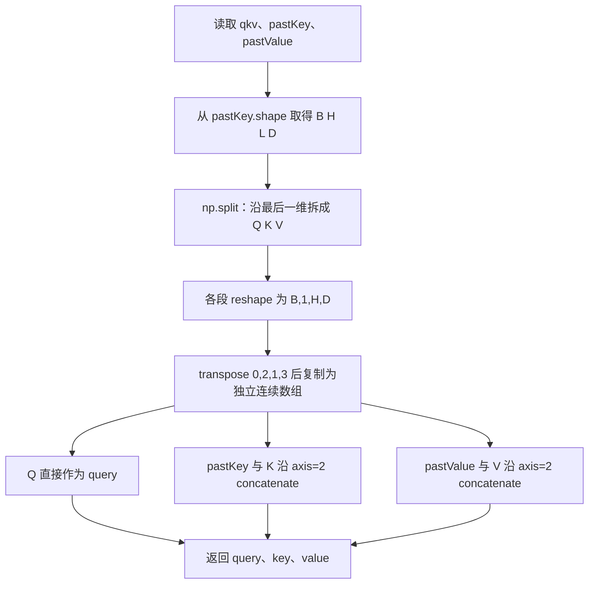
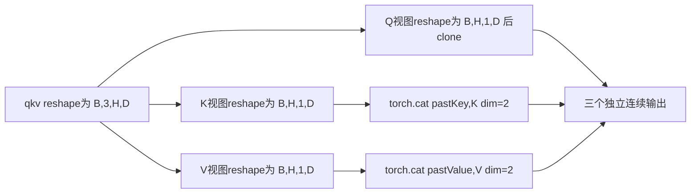
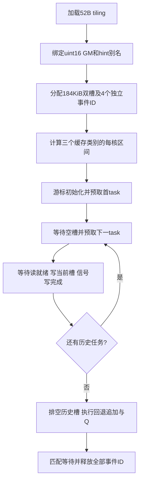

<!-- Copyright 2026 The xLLM Authors. Licensed under the Apache License, Version 2.0. -->

# 【社区任务】T5SplitQkvAppendCache算子设计文档

> 当前版本：35精度、206扩展和5批全部10个性能case通过；真实截图已补齐。当前运行依赖page_size:1g；正式环境差异仍披露。


本算子面向 T5 单 token 解码，将融合 QKV 拆分为独立 Q，并把当前 K/V 追加到连续历史缓存。设计采用一次 AIV 内核启动、逐位搬运、零显式全局工作区，同时提供 ACLNN 和 Kernel 直调入口。

本文描述已实现并在开发环境测试的版本，不把设计覆盖等同于正式验收通过。35 个官方精度 case、10 个内存 case 和随包绝对耗时检查已通过；同机合格基线与真实截图已补齐；指定环境复测及社区正式流程仍待完成。

| 版本项 | 固定内容 |
| --- | --- |
| 文档日期 | 2026-10-30 |
| 仓库与交付分支 | `https://github.com/swenzhai/xllm`，`t5-qkv-task-submission` |
| 被测实现提交 | `8ea9affaf131b22c8fb786b79da5968ce6724744`；后续附件提交与被测源码提交分别记录 |
| 算子目录 | `xllm/core/kernels/npu/xllm_ops/t5_split_qkv_append_cache/`，下文简称 OP_ROOT |
| 设计审核依据 | `asctool/docs/official/设计文档CheckList.md`，原表第 2–24 行，共 23 项 |
| CheckList SHA256 | `e36651e3c496e19ce8b279c6412c7b673c0ef5503e1fbf4796a20fb8e90502cf` |
| 代码基线 | xLLM `3967b8a20adb238fd6302020563814d5e5c03493` |

## 一、需求背景

### 1.1 需求来源

需求来自《题目3-T5QKV拆分与缓存追加算子开发任务书》及同包 `op.json`、`case.json`、`coverage_requirements.json`。任务要求向 xLLM 的 NPU 算子目录贡献可构建的 Ascend C 实现，交付 OpDef、shape/dtype 推导、tiling、私有安装包、两阶段 ACLNN API、独立 C++ 样例和 PyTorch NPU 封装，并通过直调交叉验证。

原始任务包保存在本交付的 `5 原始证据.zip` 内，目录为 `official_task_package/`（另在交付第6目录保留原件）。公开 `case.json` 的 SHA256 为 `9ce34ba31fc08abe1969ad4997f7b6173fa950533473d6977398a8ed4db741e8`。原包保持不改。其任务书文件名/哈希与 `SHA256SUMS.txt` 不一致，且任务书的相对性能要求与随包绝对时间检查器不同，具体影响见 5.1、6.2。

### 1.2 背景介绍

#### 1.2.1 算子实现与优化对象

每个解码步只有一个新 token，但输出 K/V 必须拥有独立存储，所以历史数据仍须复制。优化重点是减少框架拆分、转置和拼接所需的调度及中间张量，并使历史复制、短尾追加和 Q 复制均衡分配到 Vector Core。算法没有矩阵乘、归约或浮点运算。

任务包未提供同名 TBE Python 算子源码或 CANN TBE 算子信息库文件；在上述 xLLM 起始提交中检索也未找到同名实现。因此，本任务是按指定接口新增融合算子，不能写成已完成某个既有 TBE 算子的源码迁移，也不能声称已对齐未提供的 TBE 全部功能。

| 对照对象 | 具体文件或符号 | 用途及边界 |
| --- | --- | --- |
| 任务算子信息 | 原任务包 `op.json` | 定义 `T5SplitQkvAppendCache`、三输入三输出、FP16/BF16、ND、两个 int 属性；不是 TBE 信息库 |
| 独立功能标杆 | 原任务包 `golden.py:calculate`、`calc_expect_func` | CPU NumPy/ml_dtypes 标杆；不调用提交实现，不是 TBE 内核 |
| 指定性能基线 | 原任务书 3.3 `candidates` 中 `views_concat_q_copy` | 同机 NPU 视图拆分、Q clone、两次 concat；当前已独立进程精度资格验证并同机实测 |
| 注册与推导 | OP_ROOT `op_host/t5_split_qkv_append_cache.cpp` | OpDef、输入输出约束、shape/dtype 推导与 tiling |
| ACLNN API | 构建生成 `aclnn_t5_split_qkv_append_cache.h` | `aclnnT5SplitQkvAppendCacheGetWorkspaceSize` 与 `aclnnT5SplitQkvAppendCache`；独立样例实际调用这两个符号 |

`op.json` SHA256 为 `9bccb18b2dbfb48e7f4affc30141d0c0313d7269a1edd88cb0eab76641188357`，`golden.py` SHA256 为 `258c322025f5875bb89a2529c2d85659d96ee5bb9526f292dce3b3ca7648021a`。通过算子名、输入输出顺序、属性顺序及上述 ACLNN 符号对照，确认参考文件对应当前算子。

#### 1.2.2 算子现状分析

##### 1.2.2.1 数据类型与数据格式

输入及输出均为 FP16 或 BF16，单次调用所有张量 dtype 相同；算子注册与独立 binding 的 ACL 描述符均使用 ND。框架额外接受普通连续 rank-four 张量的 NCHW 格式标记，其线性存储在本场景与 ND 相同，不表示支持私有打包布局。CPU 输入、FP32、非连续切片和 NZ 等设备私有格式不在合同内。

##### 1.2.2.2 参考实现逻辑

`golden.py:calculate` 从历史 Key 取得 B/H/L/D，沿 `qkv` 最后一维等分成 Q/K/V。三段分别 reshape 为 `[B,1,H,D]`，交换 token/head 两轴得到 `[B,H,1,D]`，再用 `np.array(copy=True, order="C")` 创建独立连续数组。Q 直接输出，K/V 分别与历史缓存在 token 轴（axis=2）拼接。属性兼容转换在 `calc_expect_func` 中完成；合法性校验由公开验证器及提交入口承担，不能把标杆函数当作完整非法输入验证器。

任务书的 NPU 性能候选采用同一输出语义，但 K/V 仅作视图再 concat，不为当前 K/V 额外 clone；Q 显式 clone。它与 CPU 标杆的临时数组行为不同，测量时应使用任务书指定候选。

##### 1.2.2.3 参考实现流程图

下图严格对应已提供的 CPU `golden.py`，是没有同名 TBE 源码时的语义对照图，并非虚构的 TBE 执行流程。



任务书NPU性能候选的逻辑流程如下，后续同机比较应执行该候选，不能拿CPU耗时代替。



## 二、需求分析

### 2.1 外部组件依赖

| 依赖 | 目标或实测版本 | 使用位置 |
| --- | --- | --- |
| Ascend C/CANN、ACL Runtime | 9.1.0，构建目标 `ascend910_93` | AIV 内核编译、OpDef/tiling、ACLNN 生成与运行 |
| 主机平台 | aarch64 Linux | `.run` 安装包、C++ 库、Python 扩展 |
| Python | 3.12.13 | 验证脚本、扩展构建、Python 接口 |
| PyTorch | 2.10.0+cpu | ATen 张量和扩展 ABI；NPU 执行由 torch_npu 提供 |
| torch_npu | 2.10.0.post4，git `5dd8ef3f9b375b5ae4a83538d5785754148c3302` | 当前 stream、OpCommand host queue、NPU 缓存分配器 |
| NumPy / ml_dtypes | 2.2.6 / 0.6.0 | CPU 独立标杆、BF16 原始位模式 |
| 构建工具 | CMake、C++17 工具链、setuptools、wheel、ninja | 具体调用见构建脚本；工具精确版本未在全部证据中固定，不作跨版本 ABI 承诺 |

运行时不依赖 NumPy 计算输出。独立 C++ ACLNN 样例不依赖 PyTorch。自定义包安装至用户私有目录，安装脚本拒绝系统目录及当前 CANN 安装树。

### 2.2 内部适配模块

| 模块 | 具体文件 | 职责 |
| --- | --- | --- |
| 注册和 host tiling | `op_host/t5_split_qkv_append_cache.cpp` | 约束检查、输出推导、工作区0、blockDim、tilingKey |
| 共用 tiling / 地址映射 | `common/t5_split_qkv_append_cache_tiling.h` | 52 B POD、尺寸边界、任务数、分核、任务解码 |
| AIV kernel | `op_kernel/t5_split_qkv_append_cache.cpp`、`..._kernel.h` | ACLNN/直调实例共用复制实现 |
| 直调 launcher | `direct/launch.cpp`、`direct/CMakeLists.txt` | 按值传递 tiling、当前 stream 启动 |
| 框架入口 | `solution.py`、`framework/binding.cpp` | 元数据校验、新输出分配、stream/lifetime、两阶段 API |
| xLLM 原生封装 | `xllm/core/kernels/npu/xllm_ops/t5_split_qkv_append_cache.cpp`、`xllm_ops_api.h` | 接入既有 `EXEC_NPU_CMD` 机制；不是独立 binding 的同一条调用路径 |
| 构建与样例 | `scripts/`、`examples/aclnn_example.cpp` | 包构建、私有安装、扩展构建、两阶段调用与逐位检查 |
| 可测模块 | `tests/acceptance.py`、`queue_stress.py`、`cache_boundary.py`、`check_task_mapping.*` | 精度、异常、生命周期、内存、边界与地址覆盖检查 |

独立工程放在 xLLM NPU wrapper 目录旁，不修改 xllm_ops 子模块。原生 wrapper 已完成基于实际 xLLM 头文件和宏的语法/类型编译；未证明完整服务构建、链接、T5 模型业务调用或端到端推理已经集成。

### 2.3 需求模块设计

#### 2.3.1 Ascend C 算子原型

令 `R=B×H`，`N=B×H×D`。qkv 按全部 Q、全部 K、全部 V 顺序打包。

| 名称 | 输入/输出 | shape | dtype/格式 | 约束 |
| --- | --- | --- | --- | --- |
| qkv | 输入 | `[B,1,3HD]` | FP16/BF16，ND | token 维严格为1 |
| pastKey、pastValue | 输入 | `[B,H,L,D]` | 与 qkv 一致，ND | 两者 shape 完全相同，L允许0 |
| query | 输出 | `[B,H,1,D]` | 与输入一致，ND | 新分配、连续 |
| key、value | 输出 | `[B,H,L+1,D]` | 与输入一致，ND | 新分配、连续，互不共享底层存储 |
| headNum、headDim | 属性 | int 标量 | 注册默认值均为1 | 必须分别等于 H、D |

Python 调用为 `run(inputs, attributes) -> (query,key,value)`、`run_direct(inputs, attributes)`；`prepare(inputs, attributes)` 返回接收新输入列表的 callable。inputs必须是长度3的list/tuple，attributes必须为dict；两属性缺省均为1，不从非1的输入shape自动推断。属性必须为严格int，最终传给ACLNN的H/D必须与shape一致。C++ 调用使用构建生成的两阶段原型：

```cpp
aclnnStatus aclnnT5SplitQkvAppendCacheGetWorkspaceSize(
    const aclTensor* qkv, const aclTensor* pastKey,
    const aclTensor* pastValue, int64_t headNum, int64_t headDim,
    const aclTensor* query, const aclTensor* key, const aclTensor* value,
    uint64_t* workspaceSize, aclOpExecutor** executor);
aclnnStatus aclnnT5SplitQkvAppendCache(
    void* workspace, uint64_t workspaceSize,
    aclOpExecutor* executor, aclrtStream stream);
```

以构建生成的头文件为 ABI 权威。正常工作区查询必须得到0；执行阶段传 `nullptr, 0`。executor 为普通一次性对象，由执行阶段消费，不跨调用缓存复用。

直调C ABI为 `uint32_t t5qkv_launch(uint32_t block_dim, void* stream, void* qkv, void* past_key, void* past_value, void* query, void* key, void* value, T5SplitQkvAppendCacheTilingData tiling)`。原生C++接口位于`xllm::kernel::npu`，接收三个`const torch::Tensor&`和两个int64属性，返回三个Tensor的tuple。`validate_out`是只检查输出元数据/存储的工程测试helper，不是调用者提供输出的`out=`计算接口；`workspace_size`返回静态0，真实ACLNN query也会在每次正式run中独立检查0工作区。

#### 2.3.2 算子相关约束与缺失功能

`1≤B≤64`、`1≤H≤128`、`1≤D≤256`、`0≤L≤8192`，同时约束 `N(2L+3)≤2^28`。这些边界不是可任意组合的独立上限。支持奇数 D、非32 B对齐 GM 起址，以及连续且非零 storage_offset 的输入视图。

不支持多 token、GQA、RoPE、分页 KV cache、原位追加、输出别名、FP32/INT8、非连续输入或不同设备/不同dtype混用。这里的“缓存追加”生成完整新 K/V，不管理上层缓存池或页表。由于同名 TBE 源码缺失，不能给出其额外特性的已对齐清单；本实现相对任务接口没有主动删除所要求的功能。

## 三、需求详细设计

### 3.1 使能方式

先用 `scripts/build.sh` 构建注册/tiling/kernel 和 `.run`，用 `scripts/install.sh` 安装至私有前缀，再加载私有 vendor 环境并设置 `T5QKV_OPAPI_LIB`。`scripts/build_framework.sh` 构建 direct 库和 `_t5qkv` 扩展。完整命令、产物哈希和测试命令见同目录《1 自验证步骤说明》。

独立 Python 正式入口的顺序为：检查输入/属性 → NPUGuard选择输入设备并获取当前stream → 分配三块新输出 → 记录输入存储的stream使用 → `OpCommand::RunOpApi`排队 → 返回输出；callback按队列顺序异步创建描述符并执行两阶段ACLNN。这里不调用强制排空host queue的同步接口。业务调用保持异步，测试在比较或计时边界同步。

callback按值捕获六份固定`TensorMetadata`（shape、stride、dtype及视图地址）、tiling、标量和stream，不持Tensor/Storage或Python storage wrapper。worker无需销毁Python关联存储所有者；六个RAII aclTensor描述符在callback内覆盖两阶段调用。API库首次解析后保持至进程退出，避免异步任务引用卸载代码。参数错误及API失败向调用方传播，不进行吞错重试或自动切换direct；异步设备错误可能在后续同步时暴露。

直调入口沿用同样的校验、分配和排队方式，在 callback 中调用 `t5qkv_launch`。direct tiling 使用目标平台固定上限48；ACLNN tiling 从平台取得可用 AIV 核数再限制到48。两者只针对本任务目标配置交叉验证，不应当成任意型号上的通用 launcher。

原生 xLLM wrapper 使用 `EXEC_NPU_CMD`：工作区查询位于调用线程，execute 随宏的 host queue 机制提交。它与独立 binding 的 callback 内双阶段方式必须区分，其集成验证范围见 2.2。

独立binding强制ND描述符，并对非零workspace报错；原生宏使用通用tensor描述转换与工作区分配机制。该差异是原生路径仍需真实完整集成验证的原因之一，不能用独立binding的测试结果证明原生宏的所有运行行为。

### 3.2 需求总体设计

#### 3.2.1 Host侧设计

Host先校验rank、维度、dtype、ND和属性，再以uint64计算N=BHD、O=N(2L+3)，O≤2^28。共享POD为13个uint32，共52 B：B/H/L/D、tile_elements、cache_tiles_per_head、query_tiles_per_batch、cache_tasks_per_tensor、query_tasks、total_tasks、block_dim、cacheable_key_rows、bypass_value_cache。Host/device静态断言布局；direct同一共享helper。

##### 3.2.1.1 分核策略

令R=BH，E=LD，T=47104，C=ceil(E/T)，Qb=ceil(HD/T)。历史任务2RC，Q任务BQb。L>0且历史尾块tail为16元素整数倍、tail+roundUp(D,16)≤T时，当前token在最后历史tile融合搬运；否则另有2R个追加任务。total=2RC+BQb+[不融合]2R；P=min(total,availableAiv,48)。L=0无历史读写，由独立追加与Q覆盖。

每个独立缓存类别、追加和Q阶段使用连续均衡公式：数量M、起点F，q=M/P、r=M%P，核c区间为 `[F+cq+min(c,r), F+cq+min(c,r)+q+[c<r])`。缓存类别按完整head行分界，不在tile内切换hint。各核无全核barrier，输出元素唯一writer。

007/017的R=256、E=131072、C=3、tail=36864，满足融合，历史1536任务、Q16、total1552、P48。Key历史768任务每核16；Value正常前缀240行×3=720任务每核15；bypass尾16行×3=48任务每核1。Q仅16个核各1条。

##### 3.2.1.2 分块和内存优化策略

UB使用一个TBuf<VECCALC>，两槽每槽47104×2=94208 B=92KiB，总188416 B=184KiB。每槽首址32B对齐。历史尾块满足融合时先精确搬运历史，再把当前D元素追加到同一槽有效末尾，最后一次写连续有效数据；不满足条件回退独立copy。DataCopyPad使用精确有效字节数，不将padding写到邻head。最大单槽字节94208，低于扩展blockLen范围。无浮点计算、全局中间张量或显式workspace。

逻辑输入/输出均Mout=2N(2L+3)B，理想总GM有效读写=4N(2L+3)B；缓存行、写分配和运行时开销不含在此公式，不能将其命名为HBM实测带宽。

基础软件缓存预算172MiB：W=8NL+12N≤预算时正常缓存；超预算时Value输出bypass，按A=4N(L+2)、每Key行2(L+1)D计算Key正常缓存前缀。新的读平衡策略在bypass_value_cache、L>0、base=2N(2L+5)<190MiB时优先启用：Key输入和输出、QKV/Q正常缓存，Value输入正常前缀 `min(R,floor((190MiB-base)/(2LD)))`，若行数足够则向下取 `P/gcd(C,P)` 的整数倍；剩余Value输入和全部Value输出bypass。base已超190MiB时保留172MiB回退策略。

007/017的Key输入64MiB、Key输出64.03125MiB、Value输入前缀240行60MiB、QKV/Q合计0.125MiB，正常逻辑工作集188.15625MiB；不是缓存预留、实际驻留或命中率保证。GlobalTensor别名同存储仅hint不同。direct旧编译链hint无效，仅用于正确性对照。

所有最终性能进程在torch导入前设置 `PYTORCH_NPU_ALLOC_CONF=page_size:1g`，baseline同设。该进程配置改变大内存池分页/预留，实测007身份进程reserved=1075838976B=1GiB大池+2MiB小池，输出释放后仍保留。它不是workspace或UB，也不是整卡瞬时峰值。常规/expandable allocator旧试验仍有超限，本次不作跨allocator保证；不能单凭相同虚拟地址或预算公式推断物理页/缓存映射。原始诊断与失败批次另存开发checkpoint。

##### 3.2.1.3 tilingKey规划

唯一tilingKey=0，合法FP16/BF16共用uint16搬运内核。形状、尾块融合和hint分支由上述元数据/helper决定，不虚增未使用key。

#### 3.2.2 Kernel侧设计

##### 3.2.2.1 实现与地址推导

以uint16为偏移单位，r=bH+h，J=(L+1)D。data pointer已含storage_offset，不重复相加。

| 数据 | 源偏移 | 目的偏移 | 有效元素 |
| --- | --- | --- | --- |
| Q batch tile t | b×3HD+tT | b×HD+tT | min(T,HD-tT) |
| K/V历史tile t | r×LD+tT | r×J+tT | min(T,LD-tT) |
| 当前K | b×3HD+HD+hD | r×J+LD | D |
| 当前V | b×3HD+2HD+hD | r×J+LD | D |

每核用phase/task/row/tile增量游标，只有进入缓存类别时做除法求行/块，循环中自增并在边界归零。读平衡依次Key、正常Value前缀、bypass Value尾；回退计划依次正常Key前缀、bypass Key尾、Value。两槽的一任务预取流水跨类别延续，避免类别之间反复排空。HistoryWrite保存目的偏移、有效长度及enum输出类别，读写地址不依赖后续游标状态。

为每槽分别AllocEventID申请MTE2_MTE3读就绪和MTE3_MTE2写完成事件（共4个独立ID）。重用槽前等待上次写完成；GM→UB及可选融合追加完成后Set读事件，UB→GM前Wait读事件，写后Set写完成事件。最后排空所有已提交槽、匹配等待flag并ReleaseEventID。不能用两次FetchEventID当作两次独立保留。剩余独立追加及Q在槽0以同样成对事件同步，最后释放ID。没有跨核依赖、原子或数值转换；任意NaN payload等原始位保持。

DataCopyPad满足LocalTensor首址32B对齐、GlobalTensor可非32B对齐，UB及有效长度按共享边界检查；尾融合条件另有边界测试。Ascend C手册A3支持DataCopyPad和SetL2CacheHint，实际构建与NPU结果是当前版本支持的证据，不作跨型号承诺。

##### 3.2.2.2 Ascend C流程图



##### 3.2.2.3 与参考的差异和原因

参考split/reshape/transpose映射直接化为地址，不生成当前K/V中间张量；历史和新token写最终连续输出，语义保持独立存储。参考依次Q/K/V与本实现各核分阶段并行写互不相交区间等价。uint16搬运保持任意位模式；hint、双槽、游标和大页改变访存/调度，不改变输入输出合同。没有同名TBE源码，不能声称逐行对齐未知实现；真实TBE若由评审指定需补源码和流程图对照。

### 3.3 支持硬件

目标为昇腾910C / Atlas A3、Ascend910_9382、单个逻辑设备、48个Vector Core及24个Cube Core。本内核声明AIV_ONLY，不使用Cube。注册/编译目标为`ascend910_93`；没有承诺910B、初代910或950支持。

开发实测为Ascend910_9382、CANN9.1.0、Ubuntu22.04.5、driver26.1.1；验收指定openEuler24.03 LTS-SP3和driver25.5.t6.b001尚未复测。最终进程设置ASCEND_RT_VISIBLE_DEVICES=0，实际torch可见设备1个；不据此声称整机独占或物理隔离。

### 3.4 算子约束限制

除2.3.2的shape/dtype/格式约束外，三个输入必须位于同一NPU设备。Python拒绝未知属性、bool/字符串/浮点数属性及不匹配的H/D。普通C++ ACLNN调用方须保证设备指针有效、描述符ND、内存足够且输出存储不重叠，host shape推导不能检测所有底层指针所有权问题。

输入由torch_npu分配器管理时，提前释放通过记录stream使用保护；外部分配、IPC或自定义allocator的生命周期由外部拥有者负责。`prepare`只保存元数据，不缓存输入、输出、地址、stream或executor，每次调用仍分配新输出。支持动态合法尺寸的逐次eager调用，不代表已验证图捕获、图执行或训练反向。

`recordStream`保护释放/复用，不负责等待另一stream上的生产者写入完成。输入若由另一stream生产，调用者须先建立event/wait_stream依赖；输出由另一stream消费时也须履行框架的流依赖和寿命规则。`prepare`固定的是(B,H,L,D,device_index,dtype)，允许每次使用不同地址、合法storage offset和当前stream，同时重新校验连续性与基础格式。当前未验证多个host线程并发首次加载库。

## 四、特性交叉分析

| 交叉特性 | 设计行为 | 验证及边界 |
| --- | --- | --- |
| FP16/BF16与特殊位模式 | 两类型均按uint16搬运 | 官方35case全部逐位验证，含9个audit；不是数值容差测试 |
| L=0与空缓存 | 跳过历史绑定/任务/有效读 | 最小shape及大head边界用例覆盖 |
| 奇数D、尾块、storage offset | 精确字节长度、UB槽首址对齐 | 12个额外输入在两入口测试；大奇数行边界另有8条补充记录 |
| 当前stream与host queue | 排队顺序服从OpCommand；固定元数据值捕获 | 双独立stream、提前释放、长队列压力验证；不跨stream私自插入全局同步 |
| 输入提前释放 | 排队前对input storage recordStream，释放事件排在使用之后 | 各入口有提前释放压力；worker不持Python关联Tensor/Storage所有权 |
| 输出提前释放 | 输出属当前分配stream，同流后续复用在已提交操作之后 | 保留8次输出、32次提前释放输出压力；并非任意外部allocator保证 |
| 多次追加 | 前一次K/V可作为下一次历史输入；仍生成新存储 | L=31代表输入连续追加两次，最终长度L+2 |
| 内存回收与高调用数 | 零显式workspace；不保存跨调用结果 | 018两入口各20次回收，005两入口各8192次队列压力；不把重复次数当独立case |
| direct与ACLNN | 共用task映射/位复制；不同launch与hint环境 | 精度交叉验证；性能只声明ACLNN入口结果 |
| 多设备与异步错误 | 每次检查设备一致并用输入设备当前stream；失败向调用路径传播 | 非本任务的多卡通信、图捕获和外部分配生命周期未验证 |

## 五、可维可测分析

### 5.1 精度标准与性能标准

#### 精度与功能

全部输出逐位一致，差异元素数必须为0，包括任意NaN、Inf及正负零。还必须验证输入不变、输出数量/shape/dtype/device/连续性以及底层存储独立；只比较起始data pointer不能代替存储所有权检查。原版`verify.py`执行35个官方case，`tests/acceptance.py`增加两入口及工程场景。

| 已测项目 | 结果与范围 |
| --- | --- |
| 官方精度 | 35/35通过，三输出位差异均0 |
| 两入口公开精度 | 35×2=70条；不是70个独立输入 |
| 额外输入/非法场景 | 12×2=24条、28×3=84条 |
| 扩展总记录 | 206/206，含metadata6、verifier3、streams1、input_lifetime2、output_lifetime2、recovery2、append2、memory10 |
| 长队列/释放压力 | run和run_direct各8192次，且各100轮输入提前释放压力 |
| 大非对齐边界 | 8/8；两入口、两dtype、offset0/1 |
| C++ ACLNN样例 | FP16/BF16 bit_exact=1，workspace_bytes=0 |

任务映射CPU检查用于证明区间/来源映射，不替代NPU实测。复现和原始返回码见步骤说明及证据包；本次日志直接保存实际stdout/stderr；独立样例第二次配置正确vendor后通过，首次161001原件保留。

#### 性能

50次预热、200次×5轮原公开timer，取轮均墙钟us中位数，每调用新分配输出。当前实现与 `views_concat_q_copy` 同机、新进程、相同输入/allocator测量，baseline先通过35项精度和输出合同。5个独立新进程批次10/10绝对门限均通过，报告取最新visible批次；事件计时另记，非纯kernel时间。主表E/F=baseline/custom，G=F/E，量纲为无量纲。任务书“耗时比”表头歧义未由实测替代，仍需权威确认。

| 独立新进程批次 | 007(us)，上限75 | 017(us)，上限77 | 全10项 |
| --- | ---: | ---: | --- |
| performance | 72.24560 | 72.07870 | 通过 |
| same_device | 72.39960 | 72.07480 | 通过 |
| performance_repeat_02 | 72.40120 | 72.32610 | 通过 |
| performance_repeat_03 | 72.06880 | 72.56680 | 通过 |
| visible_page1g_final_performance（最新报告批次） | 72.10475 | 72.16775 | 通过 |

#### 内存

显式workspace0；10项allocated/active峰值增量≤Mout+16384B，释放回到调用前；20次回收仅018两入口。F=active增量/10^9 GB，baseline内存未测，比值不可计算。另存全部reserved字段，007身份进程1GiB大池+2MiB小池，释放输出不归还预留池。该统计不是整卡HBM峰值/全部运行时资源泄漏证明，UB184KiB属片上缓冲。

### 5.2 兼容性分析

FP16/BF16共享uint16内核，52B共享POD固定host/device布局；动态合法尺寸逐次eager调用，不承诺图捕获/反向或多host线程首次加载并发。torch_npu ABI、host队列、recordStream、cache hint及allocator分页依赖当前框架/驱动/CANN。升级版本、搬迁工程、修改shape策略或allocator须重建并复跑完整测试；direct hint差异和完整xLLM服务尚未闭合。007/017余量有限，保留全部轮样本，禁止挑最快批次掩盖失败。

## 六、交付与社区审核流程

### 6.1 设计文档PR信息

设计标题采用 `【社区任务】T5SplitQkvAppendCache算子设计文档`。Checklist要求向cann-competitions对应tasklist位置提交真实PR（非issue）、CLA及评论 `/compile` 构建。这是任务文件的正式审核要求，不是用户当前已授权的外部发帖动作。本次只提交用户指定GitHub分支；社区PR/compile未执行、CLA未核实、具体任务子目录待确认，不用commit链接代替PR。

### 6.2 未闭合事项

- 当前容器 Ubuntu22.04.5 / driver26.1.1，与任务指定 openEuler24.03 LTS-SP3 / driver25.5.t6.b001 不同；用户已指定继续当前环境。当前可见设备数1、逻辑0，不能据此证明整机物理隔离。
- 任务书“耗时比上限”和“目标耗时上限”表头量纲需发布方确认。本包分别提供原公开绝对检查与同机F/E，不把二者混为同一判据。
- 原发布manifest中的任务书文件名/内容hash与实际原件不符，12个原文件原样保留；待发布方确认权威版本。
- 同名TBE源码/信息库未提供，TBE对齐口径待确认。完整xLLM服务构建、链接、模型端到端未验证；不以独立binding结果代替。
- 社区设计PR、代码合入PR及 `/compile` 未执行，CLA状态未核实；此处不是正式验收结论。

## 七、源码与证据索引

源码固定Git提交 `8ea9affaf131b22c8fb786b79da5968ce6724744`，产品文件、4个外部集成文件及测试副本hash见 `7 待验收工程/源码文件清单.json`。原始公开12文件位于第6目录及证据ZIP `official_task_package/`。原始tar `page1g_final_evidence.tar.gz` SHA256 `2f142c1f953965ef4353df283c03086c561abdb2aa7ff3ef8e5f269a6af8bda1`，整体和126文件已核验；交付ZIP是增加ledger/截图的派生包，有独立manifest。

`raw/reports/acceptance_page1g_final_02/`含完整回归、四批性能、源/产物前后manifest和加载库身份；`raw/reports/visible_page1g_final_*`为最新三类报告批次及baseline子进程。三张原始JPG截图对应这些真实执行，三份独立log是child输出直接副本。输入/golden/output二进制未逐项归档，原固定种子生成器与输入hash支持复建；不伪称保留全部二进制。

## 附录A CheckList逐项对照

本表完整保留原表第2–24行的审核要求。状态区分文档是否覆盖、功能是否实测和社区流程是否完成；不能把“23项均已列出”解读为“23项均已通过正式审核”。

| 原行号 | 审核项目 | 原审核要求 | 本文章节 | 状态 | 对应说明 |
| --- | --- | --- | --- | --- | --- |
| 2 | 设计文档PR / 提交位置 | 要求：1、必须是 PR，不是 issue；2、提交到对应的代码仓 `https://gitcode.com/cann/cann-competitions/tree/master/04_tasks/01_community-task-2026/tasklist` 的对应位置；3、CLA 必须签署以及必须进行构建，PR 评论 `/compile` | 6.1、6.2 | 流程待完成 | 社区PR与compile未执行，具体任务子目录待确认，CLA状态未核实；不用GitHub分支充当PR。 |
| 3 | 设计文档PR / 标题 | 要求：【社区任务】${算子名称}算子设计文档，如【社区任务】Addcdiv 算子设计文档 | 标题、6.1 | 文档标题已采用；PR待创建 | 标题为【社区任务】T5SplitQkvAppendCache算子设计文档。 |
| 4 | 设计文档内容 / 一、需求背景 / 1.1需求来源 | 示例：通过社区任务完成开源仓算子贡献的需求 | 1.1 | 已覆盖 | 任务书、任务包、贡献目标与固定实现提交已列明。 |
| 5 | 设计文档内容 / 一、需求背景 / 1.2背景介绍 / 1.2.1XXX算子实现优化 | 包含 TBE 算子源码获取路径和算子信息库路径，需包含文件名，结合 aclnn 接口判断参考文件是否正确 | 1.2.1、七 | TBE来源未提供，需确认N/A | 明确未提供同名TBE/信息库；给出op.json、golden.py、OpDef和生成ACLNN头文件及符号。 |
| 6 | 设计文档内容 / 一、需求背景 / 1.2背景介绍 / 1.2.2XXX算子现状分析 / 1.2.2.1TBE算子支持的数据类型和数据格式 | 和算子信息库要求保持一致 | 1.2.2.1、2.3.1 | 任务接口已对齐；TBE对齐未证实 | FP16/BF16、ND和基础NCHW标记边界与任务信息一致。 |
| 7 | 设计文档内容 / 一、需求背景 / 1.2背景介绍 / 1.2.2XXX算子现状分析 / 1.2.2.2TBE算子实现描述 | 对 TBE 实现逻辑和实现方案进行详细描述，与 TBE 源码逻辑完全一致 | 1.2.2.2 | 参考逻辑已覆盖；同名TBE缺失 | 精确说明CPU标杆与NPU候选，不把它们称为TBE源码。 |
| 8 | 设计文档内容 / 一、需求背景 / 1.2背景介绍 / 1.2.2XXX算子现状分析 / 1.2.2.3TBE算子实现流程图 | 与 TBE 源码逻辑完全一致，需要重点关注 | 1.2.2.3 | 参考流程图已覆盖；同名TBE缺失 | 分别给出CPU标杆与任务指定NPU候选图；真实TBE若指定需补图。 |
| 9 | 设计文档内容 / 二、需求分析 / 2.1 外部组件依赖 | 根据实际情况选择已适配的外部依赖 | 2.1 | 已覆盖 | 构建/运行依赖、版本及ABI限制分列。 |
| 10 | 设计文档内容 / 二、需求分析 / 2.2 内部适配模块 | 根据实际情况选择已适配的内部模块 | 2.2 | 已覆盖 | 列出内部文件职责，明确原生wrapper与独立binding及验证范围。 |
| 11 | 设计文档内容 / 二、需求分析 / 2.3 需求模块设计 / 2.3.1 AscendC算子原型 | 除《算子任务书》中不要求适配的部分外，其他 TBE 算子对齐 | 2.3.1 | 任务原型已覆盖；TBE对齐未证实 | 三输入三输出、属性/默认值、ACLNN两阶段、direct/Python/native入口均列出。 |
| 12 | 设计文档内容 / 二、需求分析 / 2.3 需求模块设计 / 2.3.1 AscendC算子相关约束 | 填写与 TBE 算子相比缺失哪些功能 | 2.3.2、3.4 | 任务边界已覆盖；TBE差异未知 | 列明排除功能和未验证能力，不编造未知TBE的能力列表。 |
| 13 | 设计文档内容 / 三、需求详细设计 / 3.1 使能方式 | 根据实际开发任务，适配算子调用框架，当前主要是 ACLNN | 3.1 | 已覆盖 | 私有安装、ACLNN和直调使能、框架排队与原生宏路径。 |
| 14 | 设计文档内容 / 三、需求详细设计 / 3.2 需求总体设计 / 3.2.1host侧设计 / 3.2.1.1分核策略 | 描述算子数据分核策略 | 3.2.1.1 | 已覆盖 | 缓存类别/追加/Q任务、P上限、均衡公式、007融合例子和无全核barrier。 |
| 15 | 设计文档内容 / 三、需求详细设计 / 3.2 需求总体设计 / 3.2.1host侧设计 / 3.2.1.2数据分块和内存优化策略 | 描述数据块切分策略和 LocalMemory 使用情况，需要给出详细描述和计算公式 | 3.2.1.2 | 已覆盖 | 47104元素tile、尾融合、2×92KiB UB、0workspace、双缓存预算和大页池口径。 |
| 16 | 设计文档内容 / 三、需求详细设计 / 3.2 需求总体设计 / 3.2.1host侧设计 / 3.2.1.3tilingKey规划策略 | 描述 tilingKey 的设置条件 | 3.2.1.3 | 已覆盖 | 所有合法输入固定key0，dtype/shape/L2不分新key。 |
| 17 | 设计文档内容 / 三、需求详细设计 / 3.2 需求总体设计 / 3.2.2kernel侧设计 / 3.2.2.1kernel侧实现描述 | 描述 Ascend C 算子 kernel 设计，与 TBE 源码流程保持一致 | 3.2.2.1 | 任务语义已覆盖；TBE对齐未证实 | 逐位复制、偏移推导、唯一writer、空缓存、独立事件和双槽流水顺序。 |
| 18 | 设计文档内容 / 三、需求详细设计 / 3.2 需求总体设计 / 3.2.2kernel侧设计 / 3.2.2.2AscendC实现流程图 | 根据实际 AscendC 算子设计输出流程图，需要重点关注 | 3.2.2.2 | 已覆盖 | 给出与当前device源码匹配的缓存类别流水、DataCopyPad及事件释放流程。 |
| 19 | 设计文档内容 / 三、需求详细设计 / 3.2 需求总体设计 / 3.2.2kernel侧设计 / 3.2.2.3AscendC实现流程图与TBE流程图存在的差异点和原因 | 详细描述 Ascend C 与 TBE 两者实现中存在的差异点，并给出原因 | 3.2.2.3 | 参考差异已覆盖；同名TBE缺失 | 按语义标杆对照消除中间张量、分核与hint；未声称未知TBE逐行一致。 |
| 20 | 设计文档内容 / 三、需求详细设计 / 3.3 支持硬件 | 与《算子任务书》要求支持的硬件保持一致 | 3.3 | 设计目标已覆盖；正式环境待复测 | A3/910C/9382、AIV_ONLY、ascend910_93及指定/实际版本差异。 |
| 21 | 设计文档内容 / 三、需求详细设计 / 3.4 算子约束限制 | 填写 Ascend C 算子的约束限制，如不支持什么数据类型，参数只支持哪几种场景等 | 2.3.2、3.4 | 已覆盖 | shape、dtype、布局、存储、跨流依赖、allocator与未验证能力。 |
| 22 | 设计文档内容 / 四、特性交叉分析 | 原清单未附额外文字要求，保留此章节。 | 四 | 已覆盖 | 特性交叉矩阵有行为、测试范围和限制，不以笼统支持代替。 |
| 23 | 设计文档内容 / 五、可维可测分析 / 5.1精度标准/性能标准 | 精度不低于 TBE，性能不低于 TBE | 5.1、附录B/C | 精度已测；完整性能标准待闭合 | 35精度、10绝对耗时/内存结果；同机基线已测且10项更快；未知TBE性能未证明，未写性能不低于TBE。 |
| 24 | 设计文档内容 / 五、可维可测分析 / 5.2兼容性分析 | 原清单未附额外文字要求，保留此章节。 | 5.2 | 已覆盖 | 平台/框架ABI、构建路径迁移、双入口差异和升级复测范围。 |

## 附录B 全部35个官方case

尺寸元组按任务书表示(B,H,L,D)；三份XLSX主表及完整统计页均逐行保留以下相同ID。完整输入/输出shape和属性在case.json与各工作簿完整统计页，FP16/BF16输入输出每元素均为2 B。非performance项仍执行精度，只是不要求性能/内存测量。

| 官方Case ID | (B,H,L,D) | dtype | 数据模式 | 精度 | 性能/内存适用性 |
| --- | --- | --- | --- | --- | --- |
| T5SplitQkvAppendCache_000_float16_random | (1,1,0,1) | float16 | random | 通过，位差异0 | 不适用：任务书3.5 |
| T5SplitQkvAppendCache_001_float16_random | (4,8,0,64) | float16 | random | 通过，位差异0 | 适用：有实测记录 |
| T5SplitQkvAppendCache_002_float16_random | (2,3,2,5) | float16 | random | 通过，位差异0 | 不适用：任务书3.5 |
| T5SplitQkvAppendCache_003_float16_random | (3,7,31,80) | float16 | random | 通过，位差异0 | 不适用：任务书3.5 |
| T5SplitQkvAppendCache_004_float16_random | (2,3,127,65) | float16 | random | 通过，位差异0 | 不适用：任务书3.5 |
| T5SplitQkvAppendCache_005_float16_random | (1,8,128,64) | float16 | random | 通过，位差异0 | 适用：有实测记录 |
| T5SplitQkvAppendCache_006_float16_random | (8,12,512,64) | float16 | random | 通过，位差异0 | 适用：有实测记录 |
| T5SplitQkvAppendCache_007_float16_random | (16,16,2048,64) | float16 | random | 通过，位差异0 | 适用：有实测记录 |
| T5SplitQkvAppendCache_008_float16_random | (1,1,8192,128) | float16 | random | 通过，位差异0 | 适用：有实测记录 |
| T5SplitQkvAppendCache_009_float16_bits | (1,1,512,128) | float16 | bits | 通过，位差异0 | 不适用：任务书3.5 |
| T5SplitQkvAppendCache_010_bfloat16_random | (1,1,0,1) | bfloat16 | random | 通过，位差异0 | 不适用：任务书3.5 |
| T5SplitQkvAppendCache_011_bfloat16_random | (4,8,0,64) | bfloat16 | random | 通过，位差异0 | 适用：有实测记录 |
| T5SplitQkvAppendCache_012_bfloat16_random | (2,3,2,5) | bfloat16 | random | 通过，位差异0 | 不适用：任务书3.5 |
| T5SplitQkvAppendCache_013_bfloat16_random | (3,7,31,80) | bfloat16 | random | 通过，位差异0 | 不适用：任务书3.5 |
| T5SplitQkvAppendCache_014_bfloat16_random | (2,3,127,65) | bfloat16 | random | 通过，位差异0 | 不适用：任务书3.5 |
| T5SplitQkvAppendCache_015_bfloat16_random | (1,8,128,64) | bfloat16 | random | 通过，位差异0 | 适用：有实测记录 |
| T5SplitQkvAppendCache_016_bfloat16_random | (8,12,512,64) | bfloat16 | random | 通过，位差异0 | 适用：有实测记录 |
| T5SplitQkvAppendCache_017_bfloat16_random | (16,16,2048,64) | bfloat16 | random | 通过，位差异0 | 适用：有实测记录 |
| T5SplitQkvAppendCache_018_bfloat16_random | (1,1,8192,128) | bfloat16 | random | 通过，位差异0 | 适用：有实测记录 |
| T5SplitQkvAppendCache_019_bfloat16_bits | (1,1,512,128) | bfloat16 | bits | 通过，位差异0 | 不适用：任务书3.5 |
| T5SplitQkvAppendCache_020_float16_boundary | (64,128,0,256) | float16 | random | 通过，位差异0 | 不适用：任务书3.5 |
| T5SplitQkvAppendCache_021_float16_boundary | (1,128,3,255) | float16 | random | 通过，位差异0 | 不适用：任务书3.5 |
| T5SplitQkvAppendCache_022_float16_boundary | (2,1,4097,3) | float16 | random | 通过，位差异0 | 不适用：任务书3.5 |
| T5SplitQkvAppendCache_023_bfloat16_boundary | (64,128,0,256) | bfloat16 | random | 通过，位差异0 | 不适用：任务书3.5 |
| T5SplitQkvAppendCache_024_bfloat16_boundary | (1,128,3,255) | bfloat16 | random | 通过，位差异0 | 不适用：任务书3.5 |
| T5SplitQkvAppendCache_025_bfloat16_boundary | (2,1,4097,3) | bfloat16 | random | 通过，位差异0 | 不适用：任务书3.5 |
| T5SplitQkvAppendCache_audit_026_float16_bits | (64,128,0,256) | float16 | bits | 通过，位差异0 | 不适用：任务书3.5 |
| T5SplitQkvAppendCache_audit_027_float16_bits | (1,1,8192,256) | float16 | bits | 通过，位差异0 | 不适用：任务书3.5 |
| T5SplitQkvAppendCache_audit_028_float16_bits | (2,3,63,255) | float16 | bits | 通过，位差异0 | 不适用：任务书3.5 |
| T5SplitQkvAppendCache_audit_029_float16_bits | (1,128,1,1) | float16 | bits | 通过，位差异0 | 不适用：任务书3.5 |
| T5SplitQkvAppendCache_audit_030_bfloat16_bits | (64,128,0,256) | bfloat16 | bits | 通过，位差异0 | 不适用：任务书3.5 |
| T5SplitQkvAppendCache_audit_031_bfloat16_bits | (1,1,8192,256) | bfloat16 | bits | 通过，位差异0 | 不适用：任务书3.5 |
| T5SplitQkvAppendCache_audit_032_bfloat16_bits | (2,3,63,255) | bfloat16 | bits | 通过，位差异0 | 不适用：任务书3.5 |
| T5SplitQkvAppendCache_audit_033_bfloat16_bits | (1,128,1,1) | bfloat16 | bits | 通过，位差异0 | 不适用：任务书3.5 |
| T5SplitQkvAppendCache_audit_034_float16_bits | (64,128,62,256) | float16 | bits | 通过，位差异0 | 不适用：任务书3.5 |

## 附录C 十项最新性能与内存摘要

| Case ID | 当前(us) | 同机基线(us) | F/E | 绝对上限(us) | active增量(B) |
| --- | ---: | ---: | ---: | ---: | ---: |
| T5SplitQkvAppendCache_001_float16_random | 16.17680 | 89.72850 | 0.180286 | 28 | 13824 |
| T5SplitQkvAppendCache_005_float16_random | 16.81525 | 100.49075 | 0.167331 | 28 | 266752 |
| T5SplitQkvAppendCache_006_float16_random | 16.70865 | 86.72215 | 0.192669 | 29 | 12621312 |
| T5SplitQkvAppendCache_007_float16_random | 72.10475 | 238.57605 | 0.302230 | 75 | 134317568 |
| T5SplitQkvAppendCache_008_float16_random | 17.93855 | 98.75150 | 0.181653 | 29 | 4195840 |
| T5SplitQkvAppendCache_011_bfloat16_random | 16.95360 | 85.24925 | 0.198871 | 28 | 13824 |
| T5SplitQkvAppendCache_015_bfloat16_random | 17.37835 | 97.01095 | 0.179138 | 28 | 266752 |
| T5SplitQkvAppendCache_016_bfloat16_random | 17.74630 | 85.99040 | 0.206375 | 29 | 12621312 |
| T5SplitQkvAppendCache_017_bfloat16_random | 72.16775 | 238.85970 | 0.302134 | 77 | 134317568 |
| T5SplitQkvAppendCache_018_bfloat16_random | 18.45525 | 105.29490 | 0.175272 | 29 | 4195840 |

内存统计边界及全部复测样本见5.1、原始JSON与《补充测试记录》。
